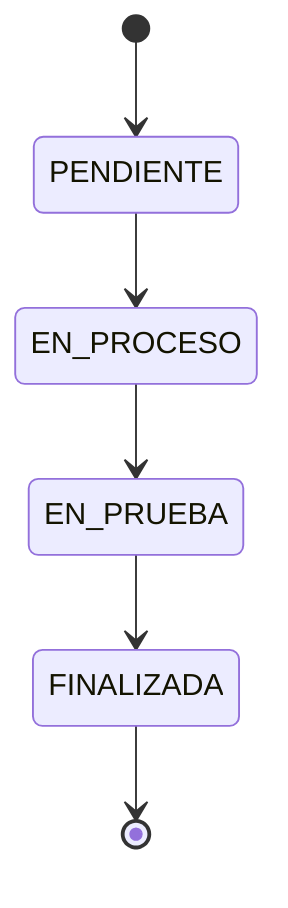
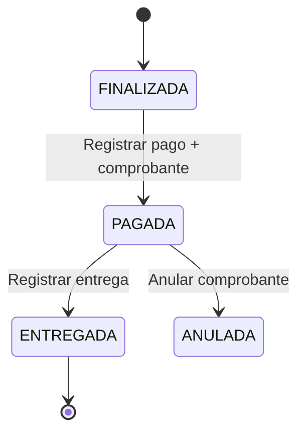
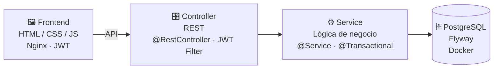

<div align="center">


**Sistema web de gestión de servicios e inventario para un taller mecánico automotriz.**
Interfaz de estilo industrial (acero, aceite, señalización), modo oscuro y animaciones fluidas.

</div>


## 📑 Contenido

| | | |
|:--|:--|:--|
| [📁 Estructura](#-estructura-del-proyecto) | [🧰 Stack](#-stack-tecnológico) | [🚀 Cómo ejecutar](#-cómo-ejecutar) |
| [🎭 Casos de uso](#-modelo-de-caso-de-uso-de-negocio) | [🔑 Credenciales](#-credenciales-de-prueba) | [🗄️ Datos semilla](#️-datos-semilla) |
| [🔄 Flujo del negocio](#-flujo-del-negocio) | [🧾 Facturación](#-facturación-boletafactura) | [🖥️ Pantallas](#️-pantallas-del-sistema) |
| [🌐 Portal del cliente](#-portal-del-cliente) | [🔒 Seguridad](#-seguridad) | [🎨 Tema y animaciones](#-tema-y-animaciones) |
| [🏗️ Arquitectura](#️-arquitectura-del-sistema) | [🔌 API REST](#-api-rest-endpoints) | [🧬 Base de datos](#-modelo-de-base-de-datos) |
| [🛠️ Problemas comunes](#️-resolver-problemas-comunes) | [⚠️ Aviso legal](#️-aviso-legal-y-parámetros-pendientes) | [📝 Changelog](CHANGELOG.md) |


## 📁 Estructura del Proyecto

<details>
<summary><b>Ver árbol de carpetas</b></summary>

```
SistemaAutoGestion/
├── README.md
├── CHANGELOG.md
├── PLAN.md
├── .env.example
├── docker-compose.yml
├── readme-assets/                     (banner.svg, divider.svg, flow.svg)
├── docs/                              (guía, manual, permisos, políticas, preguntas de defensa)
├── backend/
│   ├── Dockerfile
│   ├── pom.xml
│   └── src/main/
│       ├── java/com/autogestion/
│       │   ├── AutogestionApplication.java
│       │   ├── config/            (Security, JWT, CORS, DataInitializer, EmpresaProperties)
│       │   ├── entity/            (30 entidades JPA)
│       │   ├── repository/        (18 repositorios Spring Data)
│       │   ├── service/           (14 servicios con lógica de negocio)
│       │   ├── controller/        (17 controladores REST)
│       │   ├── dto/               (37 request/response DTOs)
│       │   └── util/              (AppTime, DocumentoValidator, NumeroALetras, Rangos, TicketPdf)
│       └── resources/db/migration/   (Flyway: V1 esquema inicial, V2 fiscal/inventario/gastos, ..., V5 portal del cliente)
├── database/
│   └── Dockerfile                 (imagen Postgres 16; el esquema lo versiona Flyway)
└── frontend/
    ├── Dockerfile
    ├── nginx.conf                 (sirve la web y reenvía /api al backend)
    ├── index.html                 (🌐 PORTAL DEL CLIENTE: identificación con documento + placa)
    ├── portal/                    (páginas del cliente: estado, cotización, comprobantes,
    │                               historial, mantenimiento, cita, encuesta, políticas)
    ├── admin/                     (🔐 ACCESO DEL PERSONAL, en /admin/)
    │   ├── index.html             (login del personal)
    │   └── pages/
    │       ├── dashboard.html         (indicadores)
    │       ├── recepcion.html         (recepción de vehículos)
    │       ├── cotizacion.html        (diagnóstico + cotización)
    │       ├── orden_trabajo.html     (órdenes de trabajo)
    │       ├── inventario.html        (gestión de inventario)
    │       ├── pago_entrega.html      (pagos, entregas, boleta/factura)
    │       ├── clientes.html / equipo.html / reportes.html
    │       ├── mecanico.html / recepcionista.html   (paneles por rol)
    │       ├── tutorial.html          (tutorial interactivo)
    │       ├── acceso_denegado.html   (error 403)
    │       └── politicas/index.html   (índice de políticas)
    ├── css/                       (compartido: styles, animations, redesign, polish, panels-premium)
    └── js/
        ├── api.js                 (cliente API del PERSONAL, permisos por rol)
        ├── portal-api.js          (cliente API del CLIENTE, token en sessionStorage)
        ├── animations.js · ui-kit.js · confirm-modal.js
        ├── vehiculos.js · vehiculo3d.js · vendor/three.module.min.js
        └── reportes/              (api-reportes, charts, export, tablas)
```

</details>


## 🧰 Stack Tecnológico

| Capa | Tecnología |
|:--|:--|
| 🖼️ **Frontend** | HTML + CSS + JavaScript (sin framework) + animaciones CSS propias |
| ⚙️ **Backend** | Java 21 / Spring Boot 3 (Spring Web, Spring Data JPA, Spring Security) |
| 🗄️ **Base de datos** | PostgreSQL 16 (vía Docker) + migraciones Flyway |
| 🔐 **Autenticación** | JWT (JSON Web Tokens) |
| 👥 **Roles** | `ADMIN` · `MECANICO` · `RECEPCIONISTA` · `ALMACENERO` |
| 📦 **Despliegue** | Docker Compose (db + backend + frontend con Nginx) |


## 🚀 Cómo Ejecutar

### Requisitos

- **Docker** → https://docs.docker.com/get-docker/
- **Docker Compose** (incluido con Docker Desktop)

### Paso 1 — Levantar el sistema

```bash
cp .env.example .env   # opcional: ajusta claves y demo (nunca subas .env)
docker compose up --build
```

Se construyen e inician 3 contenedores. Flyway crea o actualiza el esquema al arrancar el backend y conserva tus datos.

| Contenedor | Servicio | Puerto |
|:--|:--|:--|
| `db` | PostgreSQL 16 | 5433 (host) → 5432 (contenedor) |
| `backend` | Spring Boot | 8080 |
| `frontend` | Nginx | 5501 (configurable con `FRONTEND_PORT`) |

> [!NOTE]
> Se usa **5501** por defecto porque el 5500 puede estar ocupado por otro servicio del equipo. Si también está ocupado, cambia `FRONTEND_PORT` en `.env`. Espera a que los logs de los tres contenedores terminen de iniciar.

### Paso 2 — Abrir el navegador

| Quién | URL |
|:--|:--|
| 🌐 **Cliente** (portal) | http://localhost:5501/ |
| 🔐 **Personal** (login + paneles) | http://localhost:5501/admin/ |
| ⚙️ **API** (vía Nginx, mismo origen) | http://localhost:5501/api |
| 🛠️ API directa (solo depuración, solo desde tu PC) | http://localhost:8080/api |

### Paso 3 — Iniciar sesión (personal en `/admin/`)

- **Email:** `admin@sanmartin.pe`
- **Contraseña:** `Admin-2026*` (demo; cámbiala con `APP_ADMIN_PASSWORD` en tu `.env`)

### Paso 4 — Recorrer el flujo del negocio

```
Login → Dashboard → Recepción → Cotización → Órdenes de Trabajo → Inventario → Pago/Entrega
```


## 🎭 Modelo de Caso de Uso de Negocio

Actores: **Cliente, Recepcionista, Mecánico, Administrador**.

> El Recepcionista es el actor clave: registra la llegada del cliente y su vehículo, inicia la recepción y coordina el flujo inicial del taller.


## 🔑 Credenciales de Prueba

| Usuario | Email | Contraseña | Rol |
|:--|:--|:--|:--|
| Administrador | `admin@sanmartin.pe` | `Admin-2026*` | `ADMIN` |
| Luis Ramírez (Motor) | `mecanico1@sanmartin.pe` | `Meca-2026*` | `MECANICO` |
| Jorge Castillo (Frenos) | `jcastillo@sanmartin.pe` | `Meca-2026*` | `MECANICO` |
| Marco Delgado (Electricidad) | `mdelgado@sanmartin.pe` | `Meca-2026*` | `MECANICO` |
| Rosa Chávez | `recepcionista@sanmartin.pe` | `Recep-2026*` | `RECEPCIONISTA` |
| Pedro Quispe | `almacen@sanmartin.pe` | `Alma-2026*` | `ALMACENERO` |

> [!WARNING]
> Claves distintas por rol, **solo para demo local**. En producción define las tuyas en `.env` (`APP_ADMIN_PASSWORD`, `APP_SEED_PASSWORD_*`) y pon `APP_SEED_DEMO=false` para no sembrar datos de prueba.


## 🗄️ Datos Semilla

Con `APP_SEED_DEMO=true` (valor demo) se insertan automáticamente estos datos. Con `false` solo se crea el ADMIN de arranque.

| Dato | Cantidad |
|:--|:--|
| 👥 Usuarios | 6 (admin, 3 mecánicos con especialidad, almacén, recepción) |
| 🧑‍💼 Clientes | 5 (3 con DNI + 2 empresas con RUC válido) |
| 🚗 Vehículos | 4 (Corolla, Accent, Sentra, Hilux) |
| 🛠️ Servicios | 8 (cambio de aceite, alineación, frenos, etc.) |
| 📦 Productos | 12 (aceite, filtros, pastillas, discos, etc.) |

> [!IMPORTANT]
> Los datos viven en PostgreSQL dentro del contenedor Docker. Si eliminas el volumen `pgdata` se pierden y, con demo activado, se vuelven a insertar al reiniciar.


## 🔄 Flujo del Negocio


```
1. RECEPCIÓN
   └─> Registrar cliente + vehículo + problema reportado

2. DIAGNÓSTICO
   └─> El mecánico describe los hallazgos técnicos

3. COTIZACIÓN
   └─> Seleccionar servicios y productos
   └─> El total se calcula automáticamente
   └─> Aprobar o rechazar

4. ORDEN DE TRABAJO
   └─> Se crea automáticamente al aprobar la cotización
   └─> Se asigna a un mecánico
   └─> Estados: PENDIENTE → EN_PROCESO → EN_PRUEBA → FINALIZADA

5. EJECUCIÓN
   └─> El mecánico registra los productos usados
   └─> El stock se descuenta automáticamente (transacción atómica)

6. PAGO Y ENTREGA
   └─> Se registra el pago (método + comprobante BOLETA / FACTURA)
   └─> Boleta: DNI/CE/PAS + nombre. Factura: RUC 11 dígitos + razón social + dirección fiscal
   └─> Desglose: Subtotal + IGV (18%) + Total, con serie y número correlativo
   └─> La entrega del vehículo queda bloqueada hasta tener pago con comprobante
```




## 🖥️ Pantallas del Sistema

| Pantalla | Descripción |
|:--|:--|
| 🔐 **Login** | Pantalla dividida: identidad de marca (izq.) + formulario (der.), selector de tema |
| 📊 **Dashboard** | 4 indicadores animados, flujo visual, alertas de stock y accesos rápidos |
| 🧾 **Recepción** | Wizard en 4 pasos (cliente con buscador, vehículo, problema, confirmar) + lista con filtros |
| 👥 **Clientes** | Buscador, filtros, ficha con visitas/vehículos/comprobantes, activar sin borrar |
| 💬 **Cotización** | Wizard Diagnóstico → Cotización → Aprobar, cálculo en vivo, mecánicos ordenados por carga |
| 🔧 **Órdenes de Trabajo** | Kanban por estado con buscador, reasignar mecánico y cobro directo |
| 📦 **Inventario** | Stock con costo/margen, movimientos auditados (kardex), compra multilínea, mermas, proveedores y alertas |
| 💳 **Pago/Entrega** | Órdenes finalizadas, wizard BOLETA/FACTURA con totales calculados en servidor, ticket/PDF (emisor, detalle, IGV, total en letras, QR), historial con filtros y anulación (solo ADMIN) |
| 👥 **Equipo** | Personal con avatar, especialidad y carga de OT; crear, editar, desactivar y restablecer clave (solo ADMIN) |
| 📊 **Reportes** | 7 pestañas por rol (resumen, clientes, ingresos, inventario, gastos, resultado, mecánicos) con gráficos, exportación CSV y fórmula visible |
| 🎓 **Tutorial y docs** | Caso guiado de 8 pasos, glosario, tours por pantalla y carpeta `docs/` |


## 🧾 Facturación (Boleta/Factura)

El comprobante vive en la base de datos (`comprobante` + `serie_comprobante` con bloqueo pesimista). El wizard de `pago_entrega.html` consume `POST /api/comprobantes` y el total sale de la cotización en el servidor.

- RUC con dígito verificador
- IGV 18 %
- Total en letras
- Folio correlativo por serie (`B001-00000001`, `F001-00000001`)
- Ticket con QR
- Anulación con motivo (solo ADMIN)

> [!WARNING]
> El comprobante es **interno / académico**: no firma XML ni se integra con SUNAT (sin PSE/OSE, sin envío a SUNAT). La facturación electrónica real sería una fase futura con proveedor autorizado.

### Boleta vs Factura en Perú

| | 🧾 **Boleta** | 🧾 **Factura** |
|:--|:--|:--|
| **Para quién** | Consumidor final (persona natural) | Empresa o cliente que necesita crédito fiscal |
| **Documento** | DNI (8) / CE / PAS | RUC (11) obligatorio |
| **Datos extra** | Solo nombre | Razón social + dirección fiscal obligatorias |
| **IGV** | Incluido en el total (referencial) | Desglosado: Subtotal + IGV 18 % + Total |
| **Serie** | `B001` | `F001` |

### Flujo en `pago_entrega.html`

```
OT FINALIZADA
  └─> [Registrar pago] abre el wizard:
       1. Tipo de comprobante: (•) Boleta  ( ) Factura
       2. Documento: DNI 8 (boleta) o RUC 11 + razón social + dirección (factura)
       3. Método de pago: EFECTIVO · YAPE · PLIN · TRANSFERENCIA · TARJETA
       4. Desglose automático: Subtotal + IGV 18 % + Total (= cotización.total)
       5. [Confirmar pago] → POST al backend
  └─> Constancia automática: ticket con serie/número + [Imprimir]
  └─> Tarjeta con badge BOLETA B001-000123 o FACTURA F001-000045
  └─> [Registrar entrega] bloqueado hasta tener pago registrado
  └─> [Ver comprobante] reimprime la constancia en cualquier momento
```




## 🌐 Portal del Cliente

El portal es la **pantalla de inicio** (`/`). El cliente se identifica con su documento y la placa de un vehículo registrado a su nombre. Al entrar recibe un token de rol `CLIENTE` (30 min, `sessionStorage`) que solo abre `/api/portal/**`. El personal entra por `/admin/`.

| Página | Función |
|:--|:--|
| `estado.html` | **Panel del cliente**: resumen de cuenta, órdenes, vehículos, pasos de la OT y edición de celular/correo (`/api/portal/me`, `PATCH /api/portal/me/contacto`) |
| `cotizacion.html` | **Solicitud y cotizaciones reales**: el cliente pide una revisión (`/api/portal/solicitudes-cotizacion`), ve el estado y aprueba o rechaza la cotización con precios (`/api/portal/cotizaciones`) |
| `comprobantes.html` | Boletas y facturas: indica que la descarga en línea aún no está habilitada |
| `historial.html` | Historial: estado vacío explicativo (sin datos inventados) |
| `mantenimiento.html` | Próximos mantenimientos: sin recordatorios automáticos todavía |
| `cita.html` | Cita: canales reales de atención (la reserva en línea no está conectada) |
| `encuesta.html` | Encuesta: indica que aún no está conectada a la orden |
| `ayuda.html` | **Guía de uso**: 9 pasos, preguntas frecuentes, errores y cierre de sesión seguro |
| `soporte.html` | **Centro de soporte**: canales configurados, reporte por correo y privacidad |
| `politicas.html` | Políticas y consentimientos |

Para **crear una cotización**, el cliente entra a `cotizacion.html`, elige su vehículo y describe el problema: se crea una **solicitud** en estado `PENDIENTE` (sin precios). El personal la ve en `/admin/` → **Cotización** → *Solicitudes del portal* y la marca como atendida o rechazada con una nota. Para el presupuesto real, el personal registra la **Recepción**, crea el **Diagnóstico** y agrega servicios/repuestos; recién entonces el cliente ve el detalle con montos para aprobarlo o rechazarlo. El cliente nunca fija precios ni crea cargos a su nombre.

Tablas del portal: `V5__portal_cliente.sql` (`portal_acceso_log`, `otp_codigo`, `cita`, `encuesta_satisfaccion`, `consentimiento`, `solicitud_arco`, `notificacion`) y `V9__solicitud_cotizacion_cliente.sql` (`solicitud_cotizacion`).

El login, el panel, la guía y el soporte comparten `css/portal-ui.css` y `js/portal-ui.js` (cabecera, menú de cuenta, cierre de sesión con confirmación y diseño adaptable). Las pantallas que aún no tienen endpoint muestran un estado vacío claro: **no se muestran montos, citas ni nombres de ejemplo**.

### Consulta de DNI: qué funciona y qué no

> [!IMPORTANT]
> **RENIEC no publica una API abierta, gratuita y sin credenciales para consultar nombres y apellidos por DNI.** Su servicio oficial de verificación de identidad se solicita mediante convenio, requiere certificados/equipo DNIe y tiene un costo por consulta (S/ 0.40 según la ficha oficial). Los proveedores tipo Decolecta, apis.net.pe o apiperu.dev son terceros y exigen registro/token; su plan gratuito no es anónimo.

El proyecto implementa una cadena de fuentes y **nunca rellena nombres de ejemplo**:

1. **SUNAT, sin API key** (`SunatDniProvider`): convierte el DNI en su RUC 10 (`10` + DNI + dígito verificador) y busca ese RUC en el **Padrón Reducido RUC** local. Si la persona tiene RUC 10 y el padrón está importado, devuelve la razón social publicada por SUNAT. Es la única vía automática que no requiere token ni envía el DNI a un tercero.
2. **Scrall, plan API Básico gratuito** (`SCRALL_API_KEY` configurada): consulta DNI→nombres y apellidos. Es un tercero, no RENIEC, y exige registro y clave; el código no llama a su endpoint sin autenticación aunque responda, porque sus términos exigen usuario autenticado.
3. **Proveedor RENIEC autorizado** (`RENIEC_DNI_TOKEN` configurado): consulta la URL de `RENIEC_DNI_URL` (por defecto un proveedor compatible con Decolecta). Sin token, este paso se salta.
4. **dniperu.com, gratis y sin clave** (`DniPeruProvider`, habilitado por defecto): replica el flujo de `example DNI and RUC search` **en el backend**, no en el navegador. Calienta la cookie de sesión, pide el token antirrobot (`cc_get_tokens`) cuando el sitio lo exige y repite la consulta con `cc_token`/`cc_sig`; luego parsea el mensaje `Clave: valor`. Es un tercero no oficial: puede cambiar o dejar de responder, y sus términos restringen la consulta automatizada (léelos antes de usarlo en producción). Se apaga con `DNIPERU_DNI_HABILITADO=false`.
5. **Modo manual**: si ninguna fuente tiene el documento, `motivo=SIN_FUENTE` o `NO_ENCONTRADO` y el registro continúa para escribir los nombres.

Para **RUC**, además del Padrón Reducido local (`PadronRucProvider`), está `OpenRucProvider` (`openruc.com`, API pública sin clave, habilitada por defecto): devuelve razón social, estado, condición y dirección. Se apaga con `OPENRUC_RUC_HABILITADO=false`.

> [!NOTE]
> Las dos fuentes gratuitas se consultan **desde el servidor**. Antes el navegador intentaba llamarlas y fallaba con *“Solicitud de origen cruzado bloqueada”* y el portal mostraba *“La fuente de consulta no respondió”*; ese mensaje ya no debería aparecer si el backend tiene salida a Internet.

El nombre manual se guarda con `documento_verificado=false` y `fuente_verificacion=null`. Si una fuente responde, el backend **ignora el nombre enviado por el navegador**, guarda el nombre de la fuente y registra `fuente_verificacion`.

#### Habilitar SUNAT sin API key

El padrón oficial pesa ~394 MB comprimido y se actualiza a diario. No se versiona en el repositorio:

```bash
mkdir -p padron
curl -L -o padron/padron_reducido_ruc.zip https://www2.sunat.gob.pe/padron_reducido_ruc.zip
```

En `.env`:

```dotenv
PADRON_RUC_ARCHIVO=/padron/padron_reducido_ruc.zip
PADRON_RUC_IMPORTAR_AL_INICIAR=true
```

Luego `docker compose up -d backend`. La importación corre en segundo plano y puede tardar varios minutos; se puede seguir con `GET /api/admin/padron-ruc/estado` (ADMIN). Si la tabla ya tiene datos, usa `POST /api/admin/padron-ruc/importar`.

**Límites reales:** solo cubre personas con RUC 10 (no todos los DNI lo tienen), el nombre puede estar desactualizado y **no es una verificación de identidad**. Si el padrón está vacío, el proveedor se declara no disponible y no se consulta. El padrón es información pública de SUNAT, pero contiene datos personales: úsalo solo para la finalidad del taller y no lo publiques ni lo exportes sin base legal.

#### Fuente gratuita de DNI: dniperu.com (tercero, no oficial)

`DniPeruProvider` reproduce el flujo de `example DNI and RUC search/file-ssu.py`, pero del lado del servidor: calienta la cookie de sesión, pide el token antirrobot (`cc_get_tokens`) y repite la consulta con `cc_token`/`cc_sig`. Está **habilitado por defecto** para que el registro no dependa de una clave.

Riesgos que asumes al dejarlo activo:

- Es un sitio independiente, **no RENIEC**: los datos son referenciales y no constituyen verificación de identidad.
- Sus [términos](https://dniperu.com/terminos-y-condiciones/) restringen el scraping y las consultas automatizadas; si el taller opera en producción, evalúa deshabilitarlo (`DNIPERU_DNI_HABILITADO=false`) y usar Scrall o un proveedor autorizado.
- Su HTML/AJAX puede cambiar sin aviso; el proveedor entonces lanza error y la cadena sigue con la siguiente fuente o con el modo manual (nunca inventa nombres).
- Cada DNI consultado se envía a ese tercero. El límite de 12 consultas/10 min por IP ya existe para no convertirlo en un oráculo de enumeración.

#### Si el DNI no tiene RUC 10: Scrall

Scrall ofrece un **plan API Básico gratuito** para nombres, apellidos y fecha de nacimiento, con límite de 2 peticiones cada 10 segundos. No es RENIEC ni una verificación oficial; es un tercero que consume datos públicos. Para el registro de clientes de un taller, su finalidad permitida encaja (validar datos de potenciales clientes), pero debes informar al titular y tratarlo como dato personal.

1. Crea la cuenta gratuita en [dashboard.scrall.net](https://dashboard.scrall.net/) con tus datos reales.
2. Copia la clave del plan API Básico.
3. Pégala en `.env` (nunca en el frontend ni en el chat):

```dotenv
SCRALL_API_KEY=tu_clave_aqui
SCRALL_DNI_URL=https://api.scrall.net/v1/reniec/basico
```

4. Reinicia `docker compose up -d backend`.

El backend envía `Authorization: Basic <clave>` y no registra la clave ni los nombres en los logs. Sin `SCRALL_API_KEY`, el proveedor se declara no disponible y el portal sigue en modo manual. **No uses el endpoint sin clave**: sus términos exigen usuario autenticado aunque en algún momento responda.

#### RUC gratuito: openruc.com

Si el padrón no está importado o el RUC no aparece en él, `OpenRucProvider` consulta `https://openruc.com/api/ruc/{ruc}` (sin clave) y devuelve razón social, estado, condición y dirección. `{"error":"not_found"}` y 404 se tratan como “no encontrado”, no como caída. También es un tercero no oficial; se apaga con `OPENRUC_RUC_HABILITADO=false`.

La alternativa más sólida sigue siendo el padrón oficial de SUNAT en local, el plan gratuito autenticado de Scrall o un proveedor autorizado. Si el taller firma un convenio con RENIEC, puede apuntar `RENIEC_DNI_URL` a su web service; el resto del flujo ya está preparado.

| Variable | Uso |
|:--|:--|
| `PADRON_RUC_ARCHIVO` | Ruta del ZIP oficial de SUNAT dentro del contenedor (`/padron/...`). |
| `PADRON_RUC_IMPORTAR_AL_INICIAR` | `true` importa el padrón si la tabla está vacía. |
| `RENIEC_DNI_URL` | Endpoint del proveedor autorizado. Admite `{numero}` en la ruta; si no, se agrega `?numero=`. |
| `RENIEC_DNI_TOKEN` | Token del proveedor (`sk_...`). Vacío = proveedor deshabilitado. |
| `RENIEC_DNI_REQUIERE_TOKEN` | `false` solo si tu endpoint es realmente sin credenciales. |
| `RENIEC_CONSULTA_MAX` / `RENIEC_CONSULTA_VENTANA_MIN` | Límite por IP de la consulta pública (12 cada 10 min por defecto). |
| `SCRALL_API_KEY` | Clave del plan API Básico gratuito de Scrall. Vacío = deshabilitado. |
| `SCRALL_DNI_URL` | Endpoint de Scrall; por defecto `https://api.scrall.net/v1/reniec/basico`. |
| `DNIPERU_DNI_HABILITADO` | `false` apaga la fuente gratuita de DNI (dniperu.com). |
| `DNIPERU_DNI_BASE_URL` | Base del sitio; por defecto `https://dniperu.com`. |
| `OPENRUC_RUC_HABILITADO` | `false` apaga la fuente gratuita de RUC (openruc.com). |
| `OPENRUC_RUC_URL` | Endpoint de RUC; por defecto `https://openruc.com/api/ruc`. |

**Vocabulario que el portal respeta:** formato válido (8 dígitos) ≠ documento existente ≠ identidad verificada. La etiqueta “Datos de fuente externa” solo aparece si hay una fuente registrada; la verificación oficial de identidad no se realiza en el portal.

Fuentes consultadas: [ficha oficial de RENIEC](https://www.gob.pe/13549-solicitar-acceso-al-servicio-de-verificacion-de-identidad-de-personas-en-reniec-utilizar-web-service-de-datos), [identidad digital RENIEC](https://identidad.reniec.gob.pe/), [consulta de datos de persona natural](https://www.gob.pe/13545-solicitar-acceso-al-servicio-de-verificacion-de-identidad-de-personas-en-reniec-acceder-a-servicio-de-consultas-en-linea-via-internet), [términos de DNIPerú](https://dniperu.com/terminos-y-condiciones/) y [formulario de eldni](https://eldni.com/pe/buscar-por-dni). El padrón electoral y los sitios con CAPTCHA no se usan para automatizar consultas.


## 🏗️ Arquitectura del Sistema




## 🔒 Seguridad

- **Autenticación:** JWT. Dos tipos de token: personal (rol de BD) y cliente (`tipo=CLIENTE`, solo `/api/portal/**`)
- **Nginx:** límite de 20 req/min por IP en `/api/public/` (identificación y registro) y límite propio para la consulta pública de documentos
- **Consulta de documentos:** límite en memoria por IP también en el backend (`X-Real-IP` de Nginx), caché positiva/negativa y documentos enmascarados en los logs
- **Datos de identidad:** el nombre enviado por el navegador se ignora cuando una fuente externa responde; `fuente_verificacion` deja trazabilidad y no se presenta como verificación oficial
- **Roles:** ADMIN, MECANICO, ALMACENERO, RECEPCIONISTA
- **Endpoints protegidos** por rol con `@RolesAllowed` (backend) y `ROLE_PAGES` / `ROLE_NAV` (frontend)
- **Contraseñas** hasheadas con BCrypt, distintas por rol en demo
- **Secretos fuera del repo:** `.env` (ver `.env.example`); JWT, claves y modo demo por variables de entorno. Consola H2 solo en desarrollo
- **Estados tipados:** `EstadoOT`, `EstadoRecepcion`, `EstadoCotizacion` (mismo texto en BD, sin estados imposibles)

### Permisos por Rol

| Rol | Puede hacer |
|:--|:--|
| 🛡️ **ADMIN** | Dashboard, recepción, cotización, órdenes, inventario, pago/entrega, comprobantes (emitir y anular), equipo, reportes |
| 🔧 **MECANICO** | Panel mecánico, sus órdenes de trabajo (cambio de estado), inventario en lectura |
| 🧾 **RECEPCIONISTA** | Panel recepcionista, recepción, cotización, órdenes de trabajo, pago/entrega (emitir comprobantes; anular es solo ADMIN) |
| 📦 **ALMACENERO** | Dashboard, inventario (productos, movimientos, alertas de stock) |

Detalle completo en [`docs/permisos.md`](docs/permisos.md).


## 🎨 Tema y Animaciones

### Cambiar tema

Clic en el botón flotante (esquina inferior derecha) para ciclar entre:

- **Sistema** (sigue el tema del SO)
- **Claro**
- **Oscuro**

La preferencia se guarda en `localStorage`.

### Animaciones

- Entrada escalonada (stagger) en indicadores, tablas y cards
- Transiciones de página tipo SPA-light
- Microinteracciones: ripple en botones, pop en badges, elevación en hover
- Skeletons de carga y estados vacíos estilizados
- Textura sutil tipo acero en las superficies
- Flujo visual con puntos animados (pulso)

Todas se desactivan solas si el SO tiene activado `prefers-reduced-motion`.

### Helpers JS (consola del navegador)

```js
agSkeleton(container, 'table')                              // skeleton de carga
agEmptyState(container, null, 'Sin datos', 'Descripción')   // estado vacío
agFlashRow(tableRow)                                        // resalta una fila
```


## 🔌 API REST Endpoints

<details>
<summary><b>Ver endpoints principales</b></summary>

| Método | Endpoint | Descripción |
|:--:|:--|:--|
| `POST` | `/api/auth/login` | Autenticación (devuelve JWT) |
| `POST` | `/api/clientes` | Crear cliente (valida DNI/RUC/CE/pasaporte) |
| `GET` | `/api/clientes` | Listar clientes |
| `GET` | `/api/clientes/buscar?q=` | Buscar paginado por documento, nombre, teléfono o email |
| `PUT` | `/api/clientes/{id}` | Editar cliente (chequea duplicado) |
| `GET` | `/api/clientes/{id}/vehiculos` | Vehículos de un cliente |
| `GET` | `/api/clientes/{id}/resumen` | Ficha con visitas, historial y comprobantes |
| `PATCH` | `/api/clientes/{id}/activo` | Activar / desactivar sin borrar |
| `POST` | `/api/vehiculos` | Crear vehículo (placa peruana, un dueño por placa) |
| `GET` | `/api/vehiculos` | Listar vehículos |
| `POST` | `/api/recepciones` | Crear recepción |
| `GET` | `/api/recepciones` | Listar recepciones (filtro por estado) |
| `POST` | `/api/diagnosticos` | Crear diagnóstico |
| `POST` | `/api/cotizaciones` | Crear cotización |
| `GET` | `/api/cotizaciones` | Listar cotizaciones |
| `PUT` | `/api/cotizaciones/{id}/aprobar` | Aprobar cotización |
| `PUT` | `/api/cotizaciones/{id}/rechazar` | Rechazar cotización |
| `POST` | `/api/ordenes-trabajo` | Crear orden de trabajo |
| `GET` | `/api/ordenes-trabajo` | Listar órdenes de trabajo |
| `PUT` | `/api/ordenes-trabajo/{id}/estado` | Cambiar estado de la OT |
| `PUT` | `/api/ordenes-trabajo/{id}/mecanico` | Reasignar mecánico (OT abierta) |
| `POST` | `/api/ordenes-trabajo/{id}/productos-usados` | Registrar producto usado |
| `GET` | `/api/ordenes-trabajo/{id}/comprobante` | Comprobante vigente de una OT |
| `GET` | `/api/productos` | Listar productos |
| `POST` | `/api/productos` | Crear producto |
| `POST` | `/api/inventario/movimientos` | Registrar movimiento (entrada con costo, consumo, ajuste, merma) |
| `GET` | `/api/inventario/movimientos?tipo=&desde=&hasta=` | Kardex paginado con filtros |
| `GET` | `/api/inventario/alertas` | Alertas de stock bajo |
| `POST` | `/api/proveedores` | Crear proveedor (RUC validado) |
| `POST` | `/api/gastos` | Registrar gasto operativo (solo ADMIN) |
| `POST` | `/api/pagos` | Registrar pago (flujo antiguo, se mantiene) |
| `POST` | `/api/comprobantes` | Emitir boleta/factura (monto desde la cotización) |
| `GET` | `/api/comprobantes` | Listar con filtros y paginación |
| `GET` | `/api/comprobantes/previsualizar` | Totales y adquirente sin reservar número |
| `POST` | `/api/comprobantes/{id}/anular` | Anular con motivo (solo ADMIN) |
| `GET` | `/api/documentos/validar` | Validar DNI/RUC/CE/pasaporte en vivo |
| `POST` | `/api/entregas/{id}` | Registrar entrega |
| `GET` | `/api/reportes/indicadores` | Indicadores del dashboard |
| `GET` | `/api/reportes/clientes-por-dia` | Clientes atendidos por día (+ `/export?formato=csv`) |
| `GET` | `/api/reportes/ingresos?agrupar=dia\|mes` | Ingresos cobrados (solo comprobantes EMITIDO) |
| `GET` | `/api/reportes/resultado` | Utilidad = ventas sin IGV − consumos − gastos |
| `GET` | `/api/reportes/inventario/kardex/{id}` | Kardex con saldos que cuadran |
| `GET` | `/api/reportes/rendimiento-mecanicos` | OT, tiempos y consumo por mecánico |
| `POST` | `/api/public/portal/identificar` | Portal: documento + placa → token CLIENTE |
| `GET` | `/api/public/portal/documento/consultar?tipo=&numero=` | Consulta pública de nombres durante el registro (con límite por IP) |
| `GET` | `/api/public/portal/info` | Datos públicos del taller para la guía/soporte (sin datos de clientes) |
| `GET` | `/api/portal/me` | Resumen del cliente logueado (solo rol CLIENTE) |
| `PATCH` | `/api/portal/me/contacto` | El cliente actualiza su celular y correo |
| `GET` | `/api/portal/cotizaciones` | Cotizaciones del cliente autenticado |
| `GET` | `/api/portal/cotizaciones/{id}` | Detalle de una cotización propia |
| `POST` | `/api/portal/cotizaciones/{id}/aprobar` | El cliente aprueba su cotización PENDIENTE |
| `POST` | `/api/portal/cotizaciones/{id}/rechazar` | El cliente rechaza su cotización PENDIENTE |
| `GET` | `/api/documentos/consultar?tipo=&numero=` | Consulta de nombres para el personal autenticado (ADMIN/RECEPCIONISTA/MECANICO) |

</details>


## 🧬 Modelo de Base de Datos

El esquema lo versiona Flyway (`backend/src/main/resources/db/migration/`). Tablas núcleo del flujo del taller:

```
usuario
cliente ──┐
          ├── vehiculo
          │
recepcion ── diagnostico ── cotizacion ─┬─ cotizacion_servicio
                                        └─ cotizacion_producto
                               │
servicio                  orden_trabajo ── ot_producto_usado
producto ─────────────────────┘                │
                                      inventario_movimiento
                                               │
                           pago_entrega ── comprobante / serie_comprobante
```

Además existen tablas de proveedores, gastos operativos y las del [portal del cliente](#-portal-del-cliente). En total el backend mapea 30 entidades JPA.

> [!TIP]
> El pago genera un comprobante interno (serie `B001`/`F001` + correlativo + snapshot fiscal del adquirente) con constancia imprimible. Detalle en [Facturación](#-facturación-boletafactura) y en `CHANGELOG.md`.


## 🛠️ Resolver Problemas Comunes

<details>
<summary><b>"Puerto 8080 ya en uso"</b></summary>

Cierra la otra aplicación que usa ese puerto o cambia el puerto en `docker-compose.yml`:

```yaml
backend:
  ports:
    - "8081:8080"
```

</details>

<details>
<summary><b>"Docker no encontrado"</b></summary>

Instala Docker Desktop desde https://docs.docker.com/get-docker/

</details>

<details>
<summary><b>"Los contenedores no inician"</b></summary>

Verifica que Docker esté corriendo y revisa los logs:

```bash
docker compose logs
```

</details>

<details>
<summary><b>"Los datos se perdieron"</b></summary>

Si eliminaste el volumen `pgdata` se pierden los datos. Con `APP_SEED_DEMO=true` los datos demo se insertan de nuevo al reiniciar.

</details>

<details>
<summary><b>"Schema-validation: missing column" en bucle</b></summary>

Desde la v1.5.1 Flyway aplica solo las migraciones pendientes al arrancar (`baseline` en BD existentes). Si ves este error en una versión vieja, actualiza el código y ejecuta `docker compose up --build` (sin `-v`, así no pierdes datos). Usa `docker compose down -v` solo si aceptas borrar todo.

</details>

<details>
<summary><b>"FlywayException: Unsupported Database: PostgreSQL"</b></summary>

Flyway 10 trae el soporte por base de datos en módulos aparte. Sin `flyway-database-postgresql` en el `pom.xml` el backend no arranca en Docker. Ya viene incluido desde la 2.0.0; si ves el error, tu código es anterior.

</details>

<details>
<summary><b>"Recibo 403 o error CORS"</b></summary>

Asegúrate de que:

1. El frontend se sirve por HTTP (no `file://`).
2. El backend está arriba (`docker compose ps`).
3. Entras por `http://localhost:5501` (Nginx reenvía `/api`; no hagas doble clic al HTML).

</details>


## ⚠️ Aviso Legal y Parámetros Pendientes

Antes de usar el sistema en producción, el responsable del taller debe definir:

- **Datos de empresa:** `RAZON_SOCIAL`, `RUC_TALLER`, `DIRECCION`, `TELEFONO_WHATSAPP`, `CORREO_CONTACTO`.
- **Protección de datos:** `CORREO_ARCO`, `OFICIAL_DATOS`.
- **Marca / splash:** `SPLASH_TITULO`, `SPLASH_SUBTITULO`, `SPLASH_IMAGEN`.

Mientras no estén definidos, las pantallas que los usan muestran un aviso `TODO`.

- Las políticas (`docs/politicas-README.md`) son borradores técnicos y **requieren revisión legal**.
- La facturación es académica; no incluye integración con SUNAT.


<div align="center">

**Desarrollado para el taller mecánico automotriz** · Proyecto académico UTP

</div>
