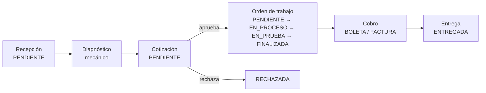
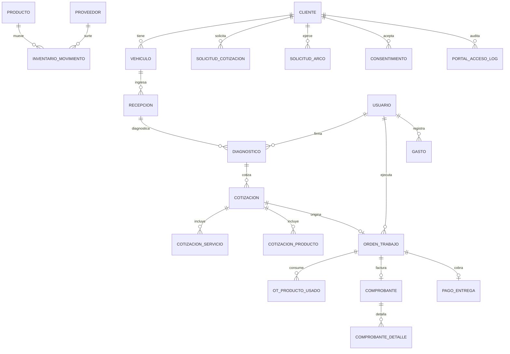

# Guía de desarrollo — AutoGestión

Referencia técnica del proyecto: cómo está organizado, qué reglas se respetan y cómo se
agrega funcionalidad sin romper lo anterior. Para el uso diario del sistema ver
[MANUAL_USUARIO.md](MANUAL_USUARIO.md); para el reparto de permisos,
[permisos.md](permisos.md).

## 1. Requisitos y arranque

| Componente | Versión |
| :-- | :-- |
| Java | 21 |
| Spring Boot | 3.3.5 |
| PostgreSQL | 16 (contenedor `db`) |
| Maven | 3.9 |
| Docker | Compose v2 |

```bash
docker compose up --build      # Postgres + backend + frontend
docker compose down            # detener (conserva los datos)
```

El frontend se sirve con nginx en `http://localhost:8081`; la API queda en
`http://localhost:8080`. Las migraciones de Flyway se aplican solas al arrancar el backend,
en orden y una sola vez.

## 2. Organización del código

### Backend (`backend/src/main/java/com/autogestion`)

| Paquete | Responsabilidad |
| :-- | :-- |
| `controller` | Expone HTTP, valida entrada con `@Valid` y declara roles con `@RolesAllowed` |
| `service` | Reglas de negocio y límites transaccionales (`@Transactional`) |
| `repository` | Consultas Spring Data JPA; las agregaciones de reportes van con JPQL |
| `entity` | Mapeo del esquema; no contiene lógica de negocio |
| `dto` | Contratos de entrada y salida; las entidades nunca se serializan |
| `config` | Seguridad, JWT, CORS, propiedades de la empresa |
| `provider` | Integraciones externas (DNI/RUC) detrás de una interfaz común |
| `util` | Generadores PDF/Excel, validadores, cifrado, reloj |

### Frontend (`frontend`)

HTML, CSS y JavaScript sin compilador ni dependencias externas: el navegador consume los
mismos archivos que sirve nginx. Las páginas del personal viven en `frontend/admin/pages/`,
las del cliente en `frontend/portal/`, y la lógica compartida en `frontend/js/`.

Una pantalla nueva se agrega en cuatro pasos: la página HTML, su entrada en el menú, la
función JavaScript que llama a la API y el endpoint que la atiende.

## 3. Flujo del taller



El portal del cliente no altera este flujo: agrega dos entradas laterales. La consulta por
documento (solo lectura) y la solicitud de cotización, que el taller atiende en recepción y
convierte en el mismo circuito de arriba.

## 4. Modelo de datos



El diagrama completo, con columnas y tipos, está en el Anexo C del informe
(`docs/evidencia/anexo-c1-modelo-datos.png`).

## 5. Reglas que no se negocian

1. **Migraciones inmutables.** Una migración aplicada no se edita: se agrega la siguiente.
   Editar una ya aplicada deja las bases de otros entornos en un estado que Flyway rechaza.
2. **`BigDecimal` para dinero.** Nunca `double`: en soles, un centavo de error es un descuadre.
3. **El monto lo calcula el servidor.** El total sale de la cotización en la misma
   transacción; lo que envíe el navegador se ignora.
4. **Snapshot en el comprobante.** Emisor y adquirente se copian al emitir: el documento
   impreso no cambia aunque el cliente actualice sus datos después.
5. **Identidad por documento.** La persona es (tipo, número). Teléfono y correo son
   contacto; jamás se usa el nombre para fusionar clientes.
6. **Baja lógica.** Se desactiva, no se borra: borrar rompería el historial de OT,
   comprobantes y movimientos.
7. **Un solo reloj.** `AppTime` fija `America/Lima` para que "hoy" signifique lo mismo en la
   caja, los reportes y los rangos de fecha.
8. **Sin datos de negocio en el navegador.** `localStorage` guarda preferencias (tema,
   guías cerradas); todo lo demás vive en la base de datos.
9. **Comprobante académico.** La estructura y las reglas SUNAT son reales, pero no hay
   firma XML ni envío a SUNAT: el pie del documento lo declara siempre.

## 6. Cómo agregar un reporte

El módulo de reportes tiene tres piezas y las tres se tocan siempre en el mismo orden.

**Paso 1 — Consulta.** En `ReporteService` agrega el método que devuelve los datos del
rango. Las fechas llegan como `LocalDate` y se convierten con `AppTime`; las sumas se hacen
en la base con JPQL, no en memoria.

**Paso 2 — Exportación.** En `ReporteExportService.exportarConsolidado` agrega el `case` al
`switch` y un método `agregarXxx` que arme la misma información dos veces: una sección
`ReportePdfGenerator.Seccion` y una `ReporteExcelGenerator.Seccion`. Un solo modelo
alimenta PDF y Excel, así los dos formatos no se contradicen.

**Paso 3 — Endpoint.** En `ReporteController` declara el `@GetMapping` con su
`@RolesAllowed` y construye el rango con el helper `rango(desde, hasta)`, que ya resuelve el
valor por defecto (mes actual) y el `+1 día` del límite superior.

**Paso 4 — Pantalla.** En `frontend/admin/pages/reportes.html` agrega la entrada a `TABS`
con sus roles, la función `tabX()` que declare datos y columnas, y el registro en el mapa de
`cargarTabActiva()`. Todo dato dinámico que entre a `innerHTML` pasa por `esc()`.

**Paso 5 — Documentación.** Actualiza esta guía, `CHANGELOG.md` y la tabla de endpoints del
`README.md`. Un reporte que no está en la tabla de endpoints no existe para quien lo busca.

## 7. Pruebas

```bash
docker run --rm -v "$PWD/backend:/app" -v "$HOME/.m2:/root/.m2" \
  -w /app maven:3.9-eclipse-temurin-21 mvn -B test
```

Surefire corre `*Test`, `*Tests` y `*IT`. Las de integración levantan el contexto completo
contra H2 en memoria con las mismas migraciones de Flyway que producción, así que el
esquema que se prueba es el esquema que se despliega.

Regla de la casa: la lógica de cálculo (IGV, folios, kardex, utilidad) lleva prueba propia
antes de tocar la pantalla. Los servicios se prueban con dobles; los flujos completos
(recepción → OT → comprobante → reportes) se prueban de extremo a extremo.

## 8. Integraciones externas

`ConsultaDocumentoService` recorre una lista de proveedores que implementan
`ProveedorDocumento` (Strategy): consulta DNI y RUC contra fuentes públicas y, si todas
fallan, devuelve `NO_ENCONTRADO` para que el usuario declare los datos a mano. El resultado
se guarda con su fuente para no repetir la consulta, y el acceso público está limitado por
`ConsultaDocumentoRateLimit`.

Las claves de los proveedores que las requieren se leen del entorno (`.env`, nunca del
código). Un proveedor sin clave se deshabilita solo al arrancar y lo deja en el log.
