# Manual de Usuario — AutoGestión

Sistema AutoGestión — Taller San Martín  
Versión 2.0 — Noviembre 2026

<!-- contenido -->

# 1. ¿Qué es AutoGestión?

AutoGestión es el sistema del Taller San Martín para manejar todo el proceso de atención de un vehículo: desde que el cliente lo deja hasta que se lo entrega reparado y con su comprobante de pago.

Tiene dos portales:

**Portal del Cliente** — para que el dueño del vehículo pueda seguir el estado de su reparación, revisar sus cotizaciones y descargar sus comprobantes sin necesidad de llamar al taller.

**Portal del Trabajador** — para el equipo interno del taller. Según tu rol (Recepcionista, Mecánico, Almacenero o Administrador), ves solo las pantallas y opciones que te corresponden.

## El flujo general del taller

Todo vehículo que entra al taller sigue este camino:

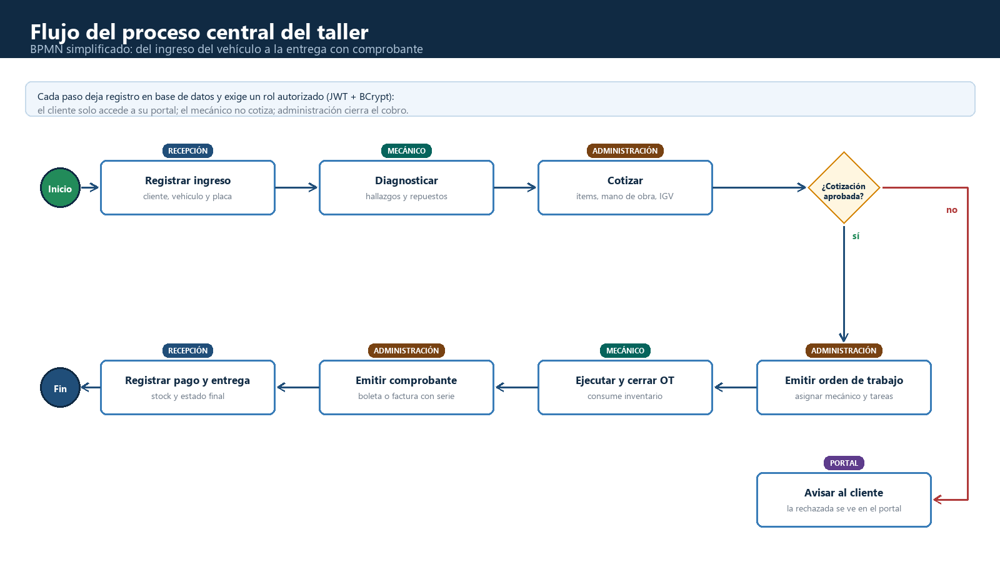

Recepción → Diagnóstico → Cotización → Aprobación del cliente → Orden de trabajo → Reparación → Pago y comprobante → Entrega

No importa qué rol tengas: tu trabajo es parte de este flujo. Más adelante se verá exactamente qué te toca hacer de acuerdo a tu rol.

# 2. Cómo entrar al sistema

## Si eres cliente

Entra desde tu navegador a la dirección del portal. Verás dos opciones:

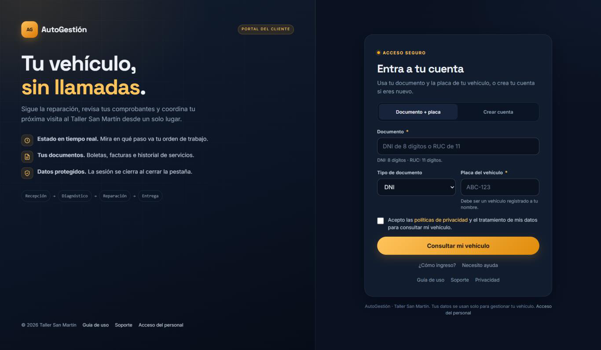

**Documento + Placa:** si ya te registraron en el taller, ingresa tu DNI (o RUC) y la placa de tu vehículo. No necesitas contraseña.

**Crear cuenta:** si es tu primera vez, llena tus datos y crea una cuenta con contraseña. La sesión se cierra cuando cierras la pestaña del navegador.

## Si eres trabajador del taller

Entra a la dirección del portal del trabajador. Verás un formulario de inicio de sesión con usuario y contraseña.

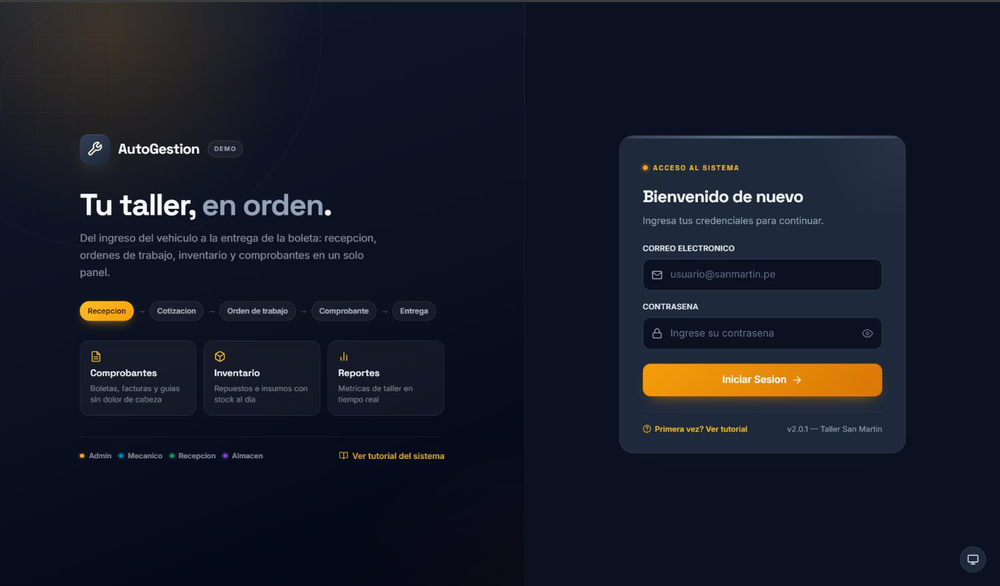

Cada trabajador tiene un usuario (correo) y una contraseña asignada por el administrador.

### Credenciales de prueba

Para demostración, el sistema incluye estos usuarios precargados:

| Rol | Usuario | Contraseña |
| --- | --- | --- |
| Administrador | admin@sanmartin.pe | Admin-2026* |
| Recepcionista | recepcionista@sanmartin.pe | Recep-2026* |
| Mecánico | mecanico1@sanmartin.pe | Meca-2026* |
| Almacenero | almacen@sanmartin.pe | Alma-2026* |

> Nota: un mecánico puede tener varias cuentas. En el sistema de prueba hay tres mecánicos disponibles.

# 3. Portal del Cliente

Cuando entras como cliente, llegas a tu panel principal. Ahí ves un saludo con tu nombre, cuántas órdenes tienes activas y tus vehículos registrados.

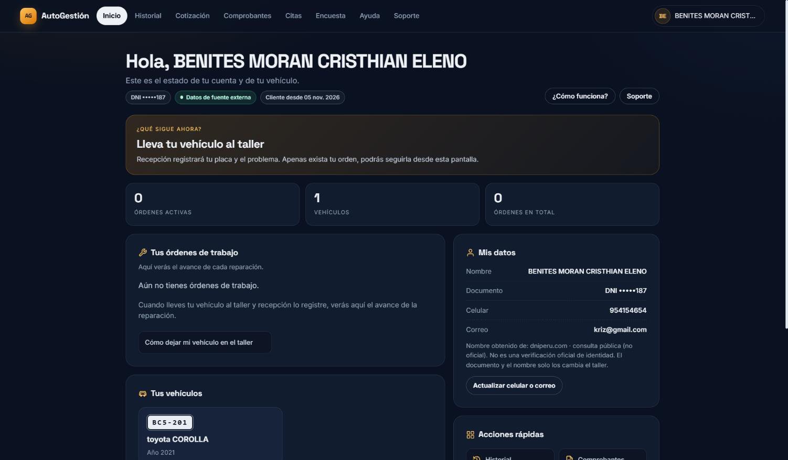

### Estado de tu vehículo

En "Tus órdenes de trabajo" ves en qué paso va la reparación de tu vehículo: si está en diagnóstico, en reparación, esperando tu aprobación o ya listo para recoger.

### Cotizaciones

Cuando el taller te prepara un presupuesto, aparece en esta sección. Puedes ver el detalle de servicios y repuestos con sus precios, y decidir si lo apruebas o lo rechazas directamente desde el portal. También puedes solicitar una cotización nueva si necesitas un servicio.

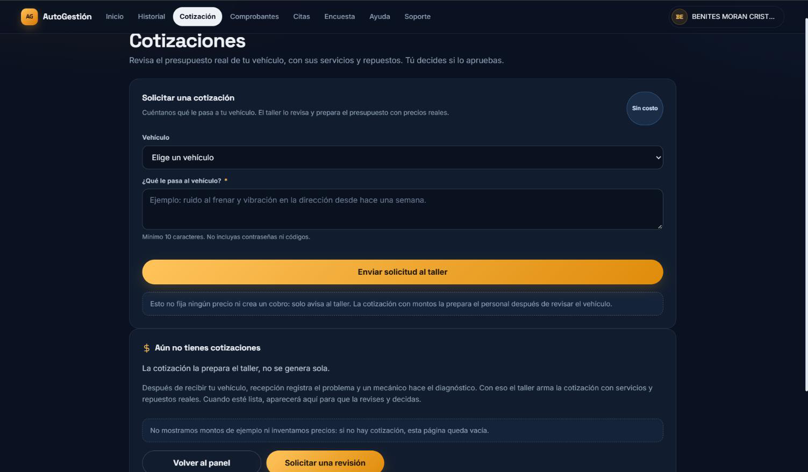

### Comprobantes

Todas las boletas y facturas emitidas a tu nombre quedan en "Mis comprobantes". Puedes descargar el PDF de cada una. Si pagaste en el taller y todavía no aparece, pídelo en recepción con tu placa.

### Historial

En "Historial" ves todas las visitas anteriores de tus vehículos, agrupadas por vehículo. Te sirve para saber cuándo fue el último servicio y planificar el siguiente.

### Solicitar una cita

Si quieres agendar tu próxima visita, puedes hacerlo desde "Soporte" o en inicio "Pedir cita".

### Tu cuenta

En "Mi cuenta" ves tus datos personales y tus vehículos. Tu celular y correo los puedes actualizar desde "Mis datos"; el nombre y documento los administra el taller. Si necesitas eliminar tu cuenta, también puedes hacerlo desde ahí: se borran tus datos personales, pero los comprobantes y órdenes emitidos se conservan por obligación contable.

# 4. Portal del Trabajador

Cuando inicias sesión como trabajador, el sistema te lleva directamente a tu pantalla principal según tu rol. Solo ves las opciones que te corresponden.

## 4.1 Recepcionista

Eres el punto de entrada y salida del taller: recibes al cliente, registras su vehículo, armas el presupuesto, y al final cobras y entregas.

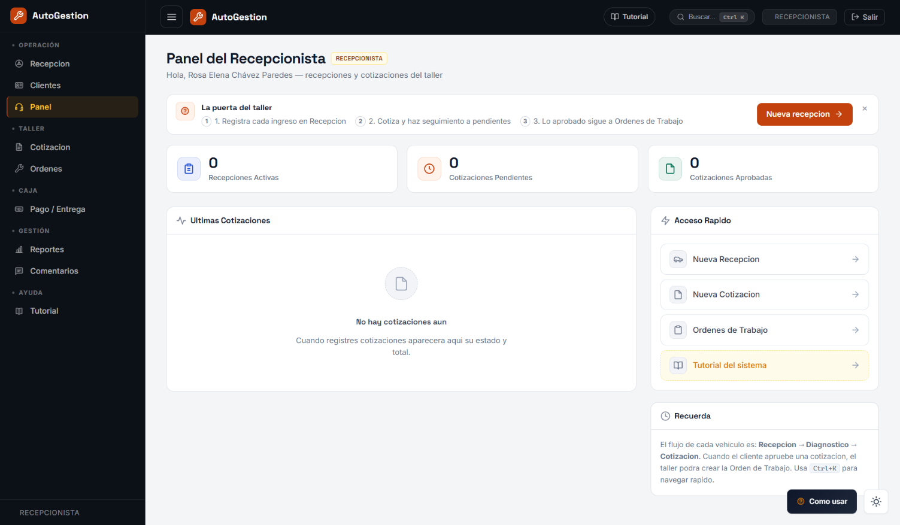

Tu panel te muestra de un vistazo cuántas recepciones tienes activas, cuántas cotizaciones están pendientes y cuántas ya fueron aprobadas. A la derecha tienes accesos rápidos a las tareas más comunes.

### Registrar una recepción

Cuando un cliente llega con su vehículo, lo registras en 4 pasos:

1. **Cliente** — buscas si ya existe (por documento, nombre o teléfono) o lo creas nuevo.
2. **Vehículo** — seleccionas de sus vehículos registrados o agregas uno nuevo (placa, marca, modelo, año).
3. **Problema** — describes qué le pasa al vehículo, nivel de combustible, kilometraje, daños previos y qué accesorios deja.
4. **Confirmar** — revisas el resumen y registras la recepción.

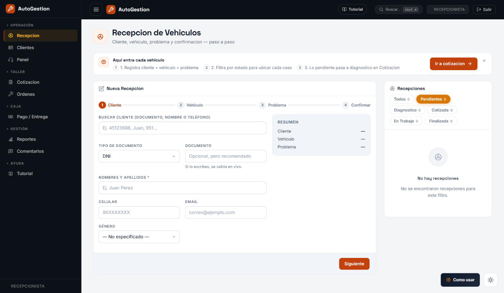

A la derecha ves la lista de todas las recepciones con filtros para ver solo las pendientes, en diagnóstico, cotizadas, etc.

### Diagnóstico y cotización

Una vez registrada la recepción, registras el diagnóstico y preparas la cotización:

1. **Diagnóstico** — seleccionas la recepción, asignas un mecánico y registras los hallazgos de la revisión.
2. **Cotización** — agregas los servicios con sus precios y los repuestos necesarios. El sistema calcula el total.
3. **Aprobación** — el cliente aprueba o rechaza desde su portal o, si es presencial, registras su decisión en el sistema.

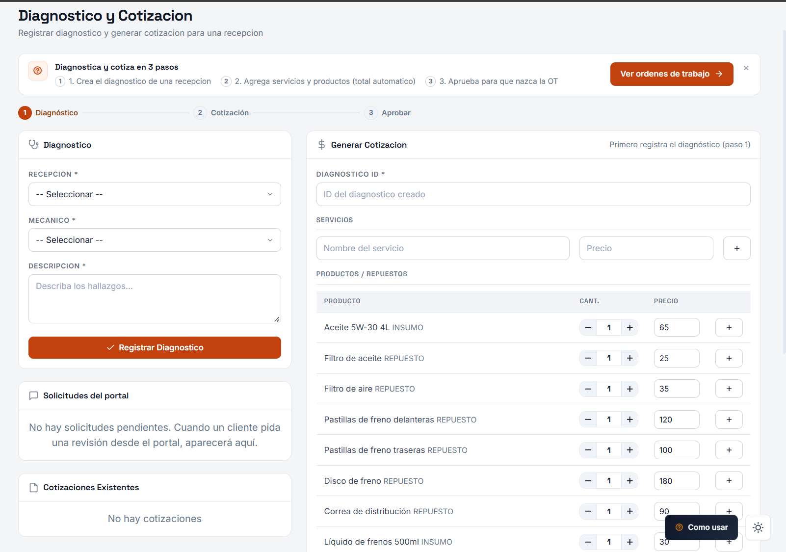

### Crear una orden de trabajo

Con la cotización aprobada, creas la orden de trabajo: seleccionas la cotización y asignas al mecánico. El sistema te muestra a los mecánicos ordenados por carga de trabajo — el que tiene menos órdenes aparece primero.

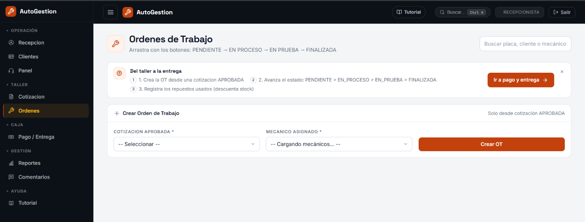

### Cobrar y entregar

Cuando el mecánico termina, te toca cobrar y entregar. En "Pago y Entrega" ves las órdenes finalizadas listas para cobrar.

1. Eliges el tipo de comprobante: Boleta (persona natural, DNI) o Factura (empresa, RUC).
2. Llenas los datos del cliente y el método de pago.
3. Confirmas y se genera el comprobante. Después registras la entrega del vehículo.

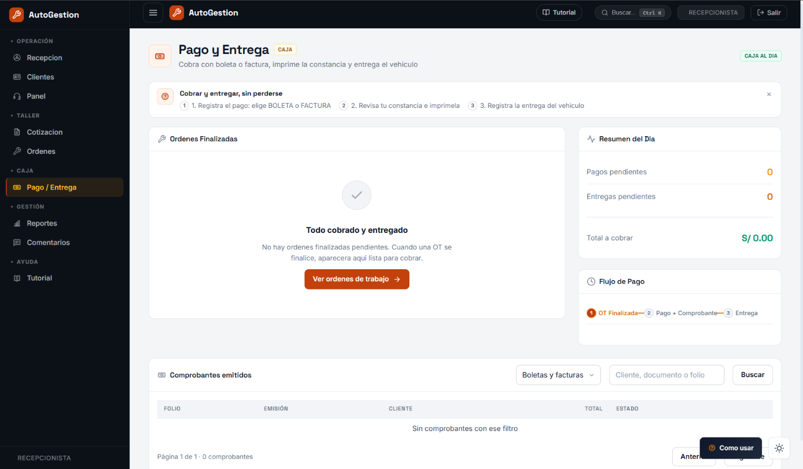

### Gestión de clientes

En "Clientes" tienes el directorio completo: busca por documento, nombre, teléfono o placa. Puedes filtrar por tipo de documento y estado (activos o inactivos), y exportar la lista a CSV.

### Comentarios

Aquí ves y gestionas los comentarios y encuestas de satisfacción que los clientes dejan desde el portal.

### Reportes

Tienes acceso al reporte de Clientes: seleccionas un rango de fechas y ves la actividad. Puedes exportar en PDF o Excel.

## 4.2 Mecánico

Tu trabajo es ejecutar las reparaciones. El sistema te muestra solo tus órdenes asignadas y el inventario de repuestos.

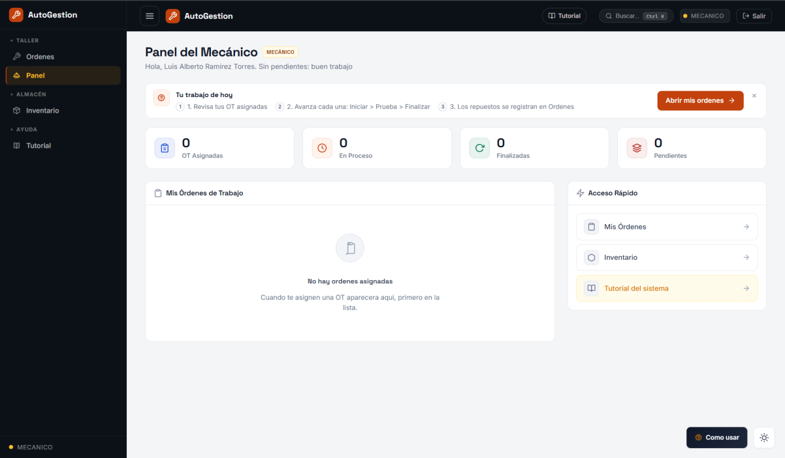

Tu panel te saluda por nombre con 4 indicadores: órdenes asignadas, en proceso, finalizadas y pendientes.

### Tus órdenes de trabajo

Debajo ves las tarjetas de cada orden con el número, estado, placa, cliente y descripción del problema. Tú avanzas el estado con los botones de cada tarjeta:

- Pendiente → "Iniciar" → pasa a En Proceso.
- En Proceso → "Pasar a prueba" → pasa a En Prueba.
- En Prueba → "Finalizar" → pasa a Finalizada.

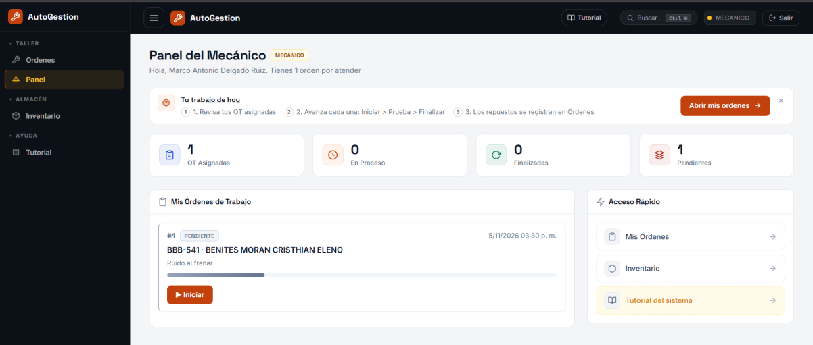

Al finalizar una orden, se habilita el cobro en recepción y ya no puedes registrar más repuestos en ella.

### Registrar repuestos usados

Mientras la orden está en proceso o en prueba, registras los repuestos que usaste con el botón "+ Repuesto". Seleccionas el producto del inventario, la cantidad, y el stock se descuenta al instante.

### Ver el inventario

Puedes consultar el inventario para saber qué repuestos hay disponibles y cuánto stock queda. Solo ves las pestañas de Stock, Movimientos y Alertas — las de compras, mermas y proveedores no te aparecen porque son del almacenero.

### Órdenes de trabajo (vista general)

También puedes ver tus órdenes asignadas en el tablero Kanban, organizadas por estado. Puedes avanzar su estado, pero no crear nuevas — eso lo hace el recepcionista.

## 4.3 Almacenero

Tu trabajo es mantener el inventario al día: registrar compras, controlar el stock y gestionar proveedores. Cuando entras al sistema, llegas directamente al inventario.

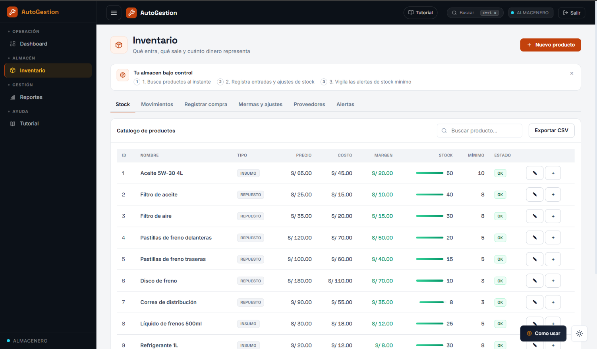

### Stock

En la primera pestaña ves todos los productos: nombre, tipo, precio de venta, costo, margen, stock actual y stock mínimo. Puedes buscar productos, ajustar cantidades, agregar nuevos y exportar la lista a CSV.

### Movimientos

El Kardex de movimientos te muestra todo lo que pasó con el inventario: entradas por compras, consumos por órdenes de trabajo, ajustes y mermas. Puedes filtrar por tipo de movimiento y rango de fechas.

### Registrar compra

Cuando llega mercadería, registras la compra: seleccionas el proveedor (o creas uno nuevo), ingresas el número de documento, y agregas las líneas con cada producto, cantidad y costo unitario. Al confirmar, el stock se actualiza automáticamente.

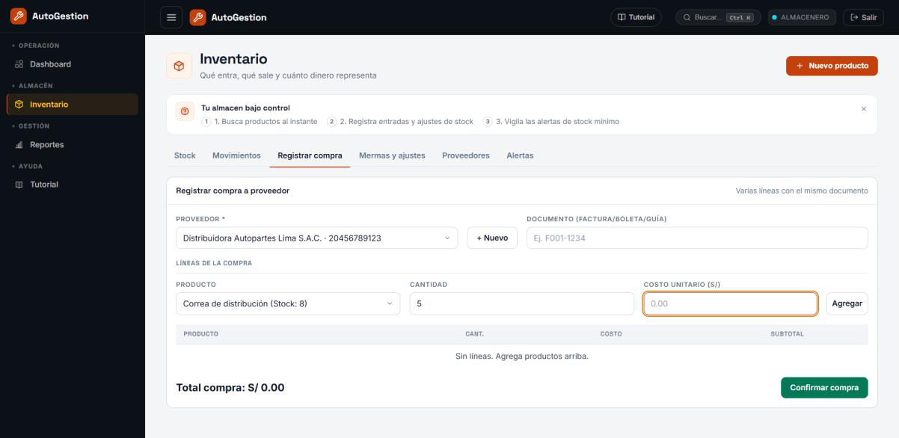

### Mermas y ajustes

Si un producto se dañó, venció o necesita un ajuste de cantidad, lo registras aquí. Cada ajuste queda auditado con motivo y responsable.

### Proveedores

Aquí gestionas el directorio de proveedores: datos de contacto, RUC y notas.

### Alertas

El sistema te avisa cuando un producto está por debajo del stock mínimo. Así puedes actuar antes de quedarte sin un repuesto importante.

### Dashboard

Además del inventario, tienes acceso al Dashboard general: un resumen visual del estado del taller con indicadores principales y alertas de stock.

### Reportes

Puedes ver el reporte de Inventario: movimientos, valores y stock filtrado por fechas. Exportable en PDF o Excel.

## 4.4 Administrador

Como administrador tienes acceso a todo el sistema. Tu pantalla principal es el Dashboard con el panorama completo del taller.

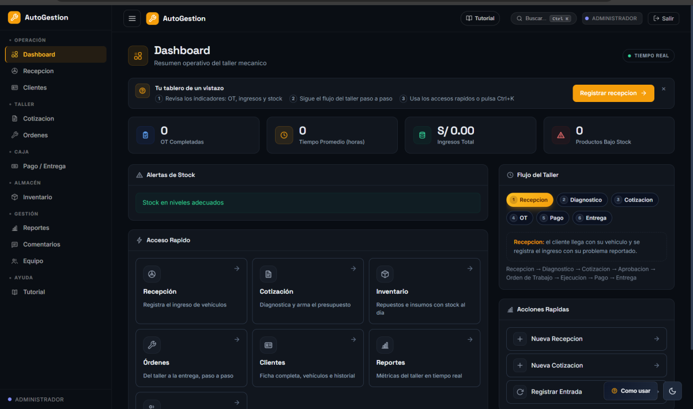

### Todo lo del recepcionista

Puedes hacer todo lo que hace el recepcionista: recepciones, cotizaciones, órdenes de trabajo, cobros y entregas, clientes y comentarios.

### Gestión de equipo

En "Equipo" administras al personal del taller: crear usuarios, asignar roles, activar o desactivar cuentas. Ves la carga de trabajo de cada mecánico y puedes filtrar por rol.

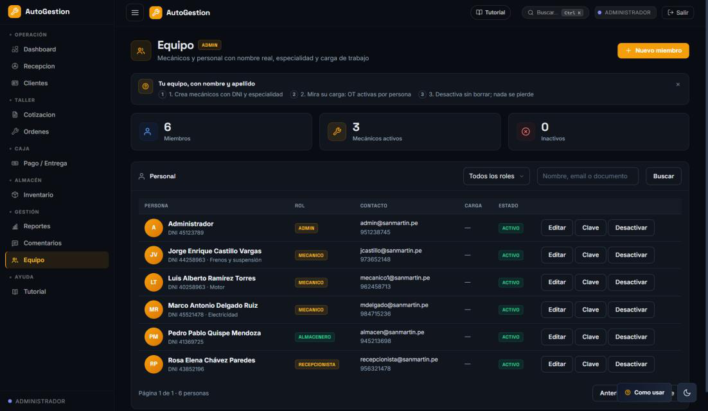

### Reportes completos

Tienes acceso a todos los reportes del sistema:

- **Resumen** — panorama general del período seleccionado.
- **Clientes** — actividad y datos de los clientes.
- **Ingresos** — lo que entró al taller por servicios.
- **Inventario** — movimientos y valores del almacén.
- **Gastos** — compras y egresos.
- **Resultado** — ganancia o pérdida del período.
- **Mecánicos** — rendimiento individual de cada mecánico.

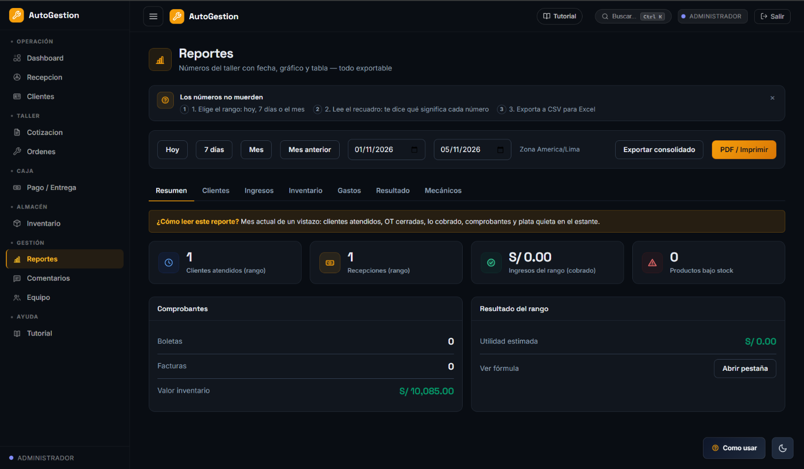

Puedes seleccionar un rango de fechas con los botones rápidos (Hoy, 7 días, Mes) o con fechas personalizadas. Cada tabla tiene su botón de Excel/PDF, y con "Exportar consolidado" generas un documento con los reportes que elijas.

# 5. Anexos

## Diagrama de arquitectura

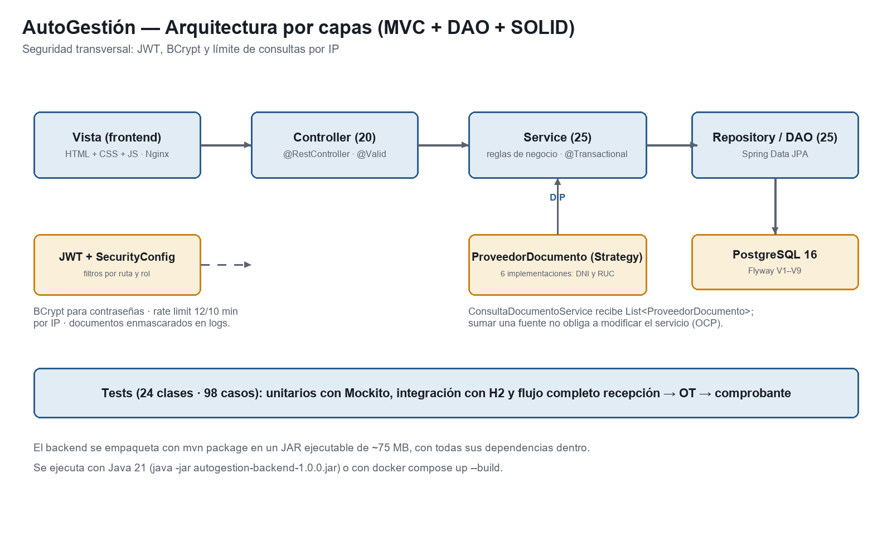

## Modelo de datos

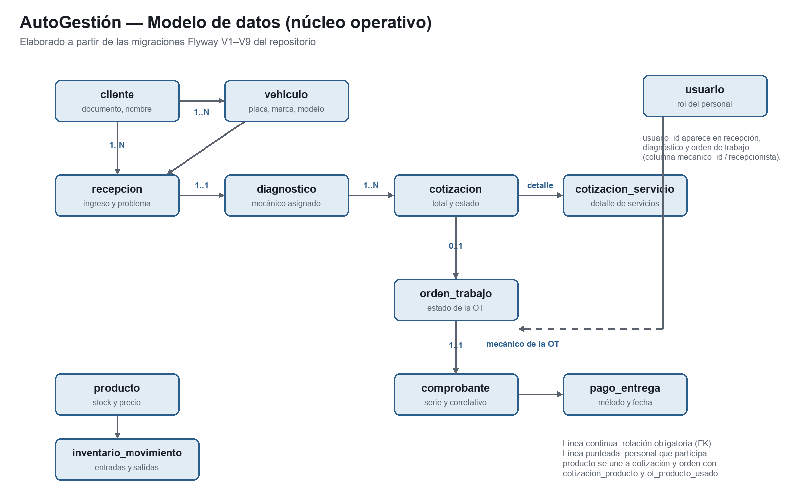
