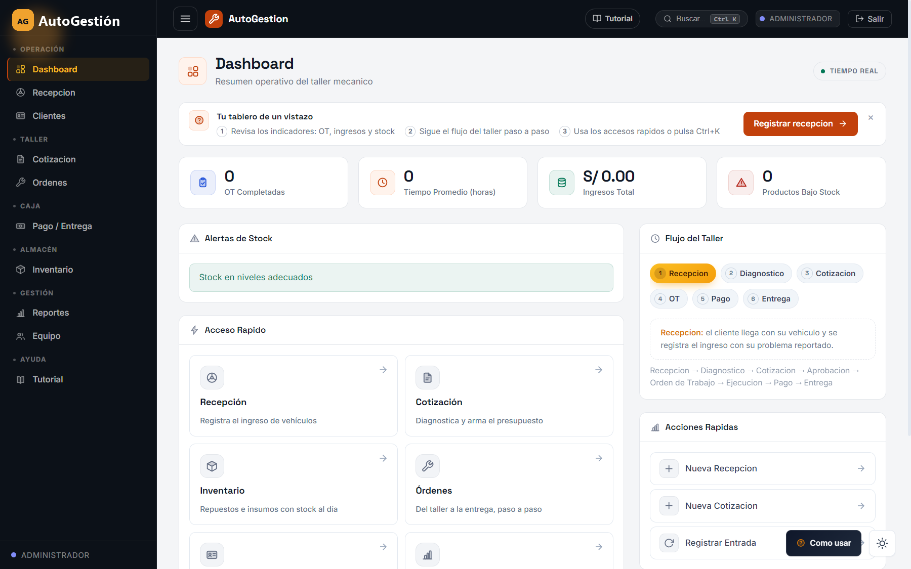
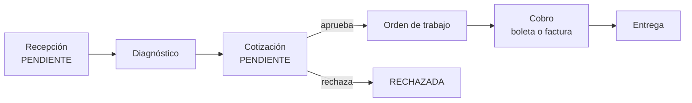
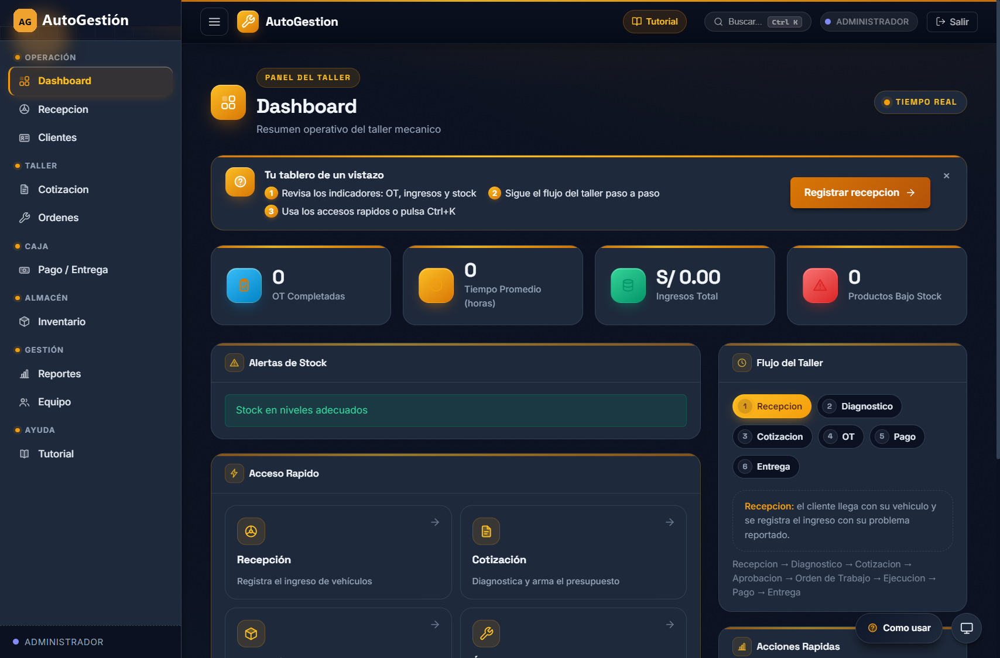
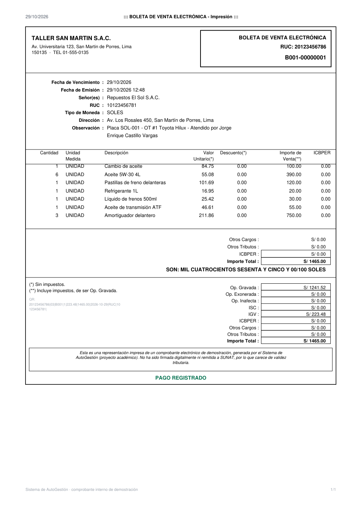
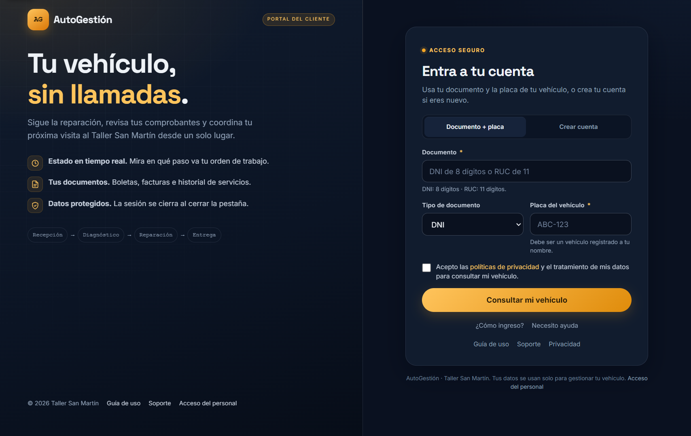

# Manual de usuario — AutoGestión

Sistema de gestión de servicios e inventario para el taller mecánico **Taller San Martín**.
Este manual explica cómo usar el sistema en el trabajo diario: qué hace cada pantalla, en qué
orden se usan, qué datos pide cada formulario y qué significa cada mensaje del sistema.

- **Versión del documento:** 2.0
- **Sistema:** AutoGestión 2.0 (Spring Boot 3 + PostgreSQL 16 + frontend HTML/CSS/JS)
- **Dirigido a:** recepción, mecánicos, almacén y administración del taller
- **Documentos relacionados:** [Guía de desarrollo](GUIA_DESARROLLO.md) (técnica),
  [Matriz de permisos](permisos.md) (quién puede qué),
  [Políticas de datos](politicas-README.md) (marco legal)

---

## Antes de empezar

### Qué es AutoGestión

AutoGestión es el sistema web del taller. Cubre el recorrido completo de un vehículo desde que
el cliente llega hasta que se va con su comprobante: recepción, diagnóstico, cotización, orden
de trabajo, consumo de repuestos, cobro, comprobante y entrega. Además controla el inventario,
los gastos y los reportes del periodo, y da al cliente un portal propio para consultar el
estado de su vehículo sin llamar por teléfono.

Son dos aplicaciones en la misma dirección web:

- el **portal del cliente**, en la raíz del sitio, sin usuario ni contraseña del personal;
- el **sistema del personal**, en `/admin/`, con usuario, contraseña y rol.

### A quién está dirigido

| Perfil | Qué encontrará aquí |
| :-- | :-- |
| Recepcionista | Recepción, cotización, órdenes, cobro y entrega paso a paso |
| Mecánico | Cómo avanzar sus órdenes y registrar repuestos |
| Almacenero | Compras, mermas, ajustes, kardex y alertas de stock |
| Administrador | Todo lo anterior más equipo, gastos, anulaciones y reportes |
| Cliente | Capítulo 16: cómo consultar su vehículo, sus comprobantes y su cuenta |

### Qué necesitas para usarlo

Un navegador actual (Chrome, Edge o Firefox) y la dirección del sistema en la red del taller.
No se instala nada en la computadora del usuario: todo ocurre en el navegador. Si el sistema
está publicado en un servidor, la dirección la entrega el administrador; en una instalación
local es `http://localhost:5501/`.

### Cómo está organizado

Los capítulos 1 a 3 son la puesta en marcha y el manejo de la interfaz. El capítulo 4 explica
el recorrido completo de un vehículo. Los capítulos 5 a 15 recorren las pantallas del personal
en el mismo orden en que se usan. El capítulo 16 es el portal del cliente. Los capítulos 17 a
21 y los anexos son de consulta: reglas, atajos, problemas, preguntas frecuentes, glosario y
datos de referencia.

---

## 1. Puesta en marcha

### 1.1 Requisitos de la instalación

Solo se necesita **Docker** con **Docker Compose** (Docker Desktop en Windows incluye ambos).
El sistema arranca tres contenedores:

| Contenedor | Función | Puerto |
| :-- | :-- | :-- |
| `db` | Base de datos PostgreSQL 16 | 5433 en el equipo → 5432 dentro del contenedor |
| `backend` | API Spring Boot | 8080 (solo local, para depuración) |
| `frontend` | Nginx con la web y el reenvío de `/api` | 5501 por defecto |

### 1.2 Levantar el sistema

Desde la carpeta del proyecto:

```bash
cp .env.example .env      # opcional: ajusta claves y datos de demo
docker compose up --build
```

La primera vez tarda varios minutos porque compila el backend y descarga la base de datos. Las
migraciones de la base se aplican solas al arrancar y **no borran lo que ya existe**. Cuando los
tres contenedores terminan de iniciar, el sistema está listo.

Para detenerlo sin perder datos: `docker compose down`. Para borrar también los datos hay que
eliminar el volumen `pgdata`, y eso no se recupera.

Si el puerto 5501 está ocupado, cambia `FRONTEND_PORT` en el archivo `.env` y vuelve a levantar
el sistema.

### 1.3 Direcciones de acceso

| Quién entra | Dirección | Qué pide |
| :-- | :-- | :-- |
| Cliente | `http://localhost:5501/` | Documento + placa del vehículo, o crear cuenta |
| Personal | `http://localhost:5501/admin/` | Correo y contraseña |
| API (referencia) | `http://localhost:5501/api` | Token de sesión |

No abras los archivos HTML haciendo doble clic: la web tiene que servirse por HTTP para que el
navegador pueda llamar a la API. Si entras por `file://`, las peticiones fallan.

### 1.4 Usuarios de demostración

Estos usuarios existen solo con datos de demostración activados (`APP_SEED_DEMO=true`):

| Rol | Correo | Contraseña |
| :-- | :-- | :-- |
| Administrador | `admin@sanmartin.pe` | `Admin-2026*` |
| Recepcionista | `recepcionista@sanmartin.pe` | `Recep-2026*` |
| Mecánico (motor) | `mecanico1@sanmartin.pe` | `Meca-2026*` |
| Mecánico (frenos) | `jcastillo@sanmartin.pe` | `Meca-2026*` |
| Mecánico (electricidad) | `mdelgado@sanmartin.pe` | `Meca-2026*` |
| Almacenero | `almacen@sanmartin.pe` | `Alma-2026*` |

Las contraseñas de demostración son públicas: **cámbialas antes de trabajar con datos reales**
desde *Equipo → Restablecer clave*, y define tus propias claves en el archivo `.env`.

### 1.5 Primer inicio de sesión

1. Abre `http://localhost:5501/admin/`.
2. Escribe el correo y la contraseña. El botón del ojo muestra u oculta la contraseña.
3. Pulsa **Entrar**. Si los datos son correctos llegas al *Dashboard*; si no, el sistema avisa
   que las credenciales no son válidas sin decir cuál de los dos campos está mal.
4. La sesión caduca sola por seguridad. Cuando eso ocurre, la siguiente acción te devuelve al
   login; vuelve a entrar y continúa donde estabas.

### 1.6 Cerrar sesión correctamente

Pulsa **Salir** en la barra superior. El sistema pide confirmación y descarta el token de la
sesión. Cierra también la pestaña si el equipo es compartido: en un taller hay datos de
clientes en pantalla y la sesión abierta permite cobrar y anular.

---

## 2. La interfaz del personal

### 2.1 Menú lateral

El menú está agrupado por el momento del trabajo, no por módulo técnico:

| Grupo | Páginas |
| :-- | :-- |
| Operación | Dashboard, Recepción, Clientes |
| Taller | Cotización, Órdenes |
| Caja | Pago / Entrega |
| Almacén | Inventario |
| Gestión | Reportes, Equipo |
| Ayuda | Tutorial |

Solo aparecen las páginas que corresponden a tu rol. Que una página no esté en el menú no es un
error: es una restricción de permisos, y el servidor también la aplica aunque alguien escriba la
dirección a mano.

### 2.2 Barra superior

De izquierda a derecha: el botón que pliega el menú, la marca del sistema, **Tutorial**, el
buscador, el rol con el que estás conectado y **Salir**. El nombre del rol es la forma más
rápida de saber con qué permisos estás trabajando cuando hay varias sesiones abiertas.

### 2.3 Banner de tres pasos y botón "¿Cómo usar?"

Cada pantalla principal muestra un banner con los tres pasos de esa página y un botón de acción
directa. Se oculta con la **✕** y no vuelve a aparecer en esa pantalla para ese usuario.

El botón flotante **¿Cómo usar?** (esquina inferior derecha) abre el recorrido guiado de la
pantalla en la que estás: resalta los elementos y explica qué hace cada uno. Es la forma más
rápida de orientarse la primera vez que se abre un módulo.

### 2.4 Buscador de páginas: Ctrl + K

Pulsa **Ctrl + K** en cualquier pantalla del personal. Escribe parte del nombre de la página o
de lo que quieres hacer ("presupuesto", "stock", "utilidad") y el buscador propone la página,
con una descripción. Enter abre la primera coincidencia.

### 2.5 Tema claro, oscuro y del sistema

El botón flotante de tema (esquina inferior derecha) alterna entre **sistema**, **claro** y
**oscuro**. "Sistema" sigue la configuración del equipo. La preferencia se guarda en el
navegador y se mantiene entre sesiones. Ambos temas muestran la misma información: el oscuro es
el original del sistema y el claro sirve para pantallas con mucha luz.



### 2.6 Avisos, badges y semáforos

- **Badge de color:** una etiqueta corta junto al título indica el área (CAJA, ADMIN, CLIENTES)
  o el estado de un registro.
- **Verde / ámbar / rojo:** el semáforo del inventario señala stock suficiente, stock en el
  límite y stock bajo o agotado. En el dashboard y en reportes, el rojo cuenta productos bajo
  stock.
- **Mensajes verdes** confirman una operación guardada; **rojos** explican por qué no se pudo
  guardar. No cierres el formulario sin leer el mensaje: casi siempre indica el campo exacto.

### 2.7 Si aparece "Acceso denegado"

Es la pantalla de error 403: entraste con un usuario cuyo rol no puede abrir esa página. Vuelve
al dashboard con el botón correspondiente o pide al administrador que revise tu rol en
*Equipo*. No es un fallo del sistema ni una sesión caducada.

---

## 3. Roles y permisos

| Rol | Puede hacer | No puede |
| :-- | :-- | :-- |
| **ADMIN** | Todo: recepción, cotización, órdenes, inventario, cobro, anulación, equipo, gastos, todos los reportes | — |
| **RECEPCIONISTA** | Recepción, clientes, cotización, órdenes, cobro y entrega, emitir comprobantes | Anular comprobantes, gestionar equipo, gastos, reportes de resultado |
| **MECÁNICO** | Ver su panel y sus órdenes, avanzar estados, registrar repuestos usados, consultar inventario | Cotizar precios, cobrar, anular, gestionar equipo |
| **ALMACENERO** | Inventario completo: productos, compras, mermas, ajustes, proveedores, kardex, reporte de inventario | Cobrar, cotizar, gestionar equipo |
| **CLIENTE** (portal) | Ver sus vehículos, sus órdenes y comprobantes, aprobar o rechazar su cotización, pedir una revisión, calificar la visita | Ver datos de otros clientes, fijar precios, crear cargos |

La autorización real ocurre en el servidor, endpoint por endpoint. El menú solo oculta lo que no
te corresponde. El detalle completo está en [permisos.md](permisos.md).

---

## 4. El recorrido completo de un vehículo

Este es el proceso que el sistema espera. Cada paso deja registro en la base de datos y lo hace
un rol concreto.


| # | Paso | Quién | Pantalla | Resultado |
| :-: | :-- | :-- | :-- | :-- |
| 1 | Registrar el ingreso | Recepción | Recepción | Cliente, vehículo y problema registrados; recepción `PENDIENTE` |
| 2 | Diagnosticar | Mecánico / Recepción | Cotización | Diagnóstico con hallazgos y mecánico asignado |
| 3 | Cotizar | Recepción / Admin | Cotización | Servicios y repuestos con total calculado |
| 4 | Aprobar | Cliente / Recepción | Cotización o portal | Cotización `APROBADA`; queda lista para la OT |
| 5 | Emitir la orden | Recepción | Órdenes | OT asignada a un mecánico, `PENDIENTE` |
| 6 | Ejecutar y cerrar | Mecánico | Órdenes / Panel del mecánico | OT `EN_PROCESO` → `EN_PRUEBA` → `FINALIZADA`, con repuestos descontados |
| 7 | Cobrar | Recepción | Pago / Entrega | Pago registrado y comprobante emitido con serie y número |
| 8 | Entregar | Recepción | Pago / Entrega | Vehículo entregado; el cliente ya puede calificar |



Si la cotización se rechaza, el circuito termina ahí: no se genera orden de trabajo ni se cobra.
El vehículo puede volver a cotizarse con un diagnóstico nuevo cuando el cliente lo decida.

---

## 5. Dashboard

Es la pantalla de llegada del personal y responde una pregunta: *¿cómo está el taller hoy?*



**Indicadores superiores.** Cuatro cifras en tiempo real:

| Indicador | Qué cuenta |
| :-- | :-- |
| OT completadas | Órdenes de trabajo terminadas |
| Tiempo promedio (horas) | Duración media del trabajo en el taller |
| Ingresos total | Dinero cobrado con comprobante emitido |
| Productos bajo stock | Repuestos e insumos en o por debajo de su mínimo |

**Alertas de stock.** Lista los productos que necesitan reposición. Si todo está en orden,
muestra "Stock en niveles adecuados" en verde.

**Flujo del taller.** Los seis pasos del proceso (Recepción → Diagnóstico → Cotización → OT →
Pago → Entrega) con una explicación del paso seleccionado. Sirve para explicar el sistema a
alguien nuevo sin salir del dashboard.

**Acceso rápido.** Tarjetas a Recepción, Cotización, Inventario y Órdenes, más acciones
directas como *Nueva recepción*, *Nueva cotización* y *Registrar entrada*.

**Tiempo real.** El indicador de la esquina superior derecha confirma que las cifras se
refrescan sin recargar la página.

---

## 6. Recepción de vehículos

### 6.1 Para qué sirve

Registra la llegada del vehículo: quién es el cliente, qué vehículo es, qué problema reporta y
en qué condiciones se entrega. De aquí sale el número de recepción que siguen los demás pasos.

### 6.2 Paso 1 — Cliente

1. Escribe en **Buscar cliente** el documento, el nombre o el teléfono. Ejemplo: `45123698`,
   `Juan`, `951...`.
2. Si el cliente ya existe, aparece su tarjeta: elígela y pasa al paso 2.
3. Si no existe, completa el formulario de alta:
   - **Tipo de documento:** DNI, RUC, CE o Pasaporte.
   - **Documento:** opcional pero recomendado; se valida en vivo.
   - **Nombres y apellidos.**
   - Solo si es RUC: **Razón social** y **dirección fiscal**.
   - **Celular** (9 dígitos) y **correo**.
   - **Género** (opcional).
4. El sistema consulta los datos públicos del documento y, cuando una fuente responde,
   completa el nombre por ti. Si ninguna responde, escribe los nombres a mano: el registro
   continúa igual, solo queda marcado que el dato no vino de una fuente.

> El documento identifica a la persona. El teléfono y el correo son datos de contacto: cambian,
> el documento no. Nunca fusiones dos clientes "porque el nombre se parece".

### 6.3 Paso 2 — Vehículo

1. Si el cliente ya tiene vehículos, aparecen como tarjetas: elige el correcto.
2. Si es nuevo, completa: **Placa** (`ABC-123`), **año**, **marca** (lista con opción de
   escribirla) y **modelo**.
3. La vista previa muestra el vehículo mientras lo describes; sirve para confirmar que es el
   correcto antes de seguir.

Una placa pertenece a un solo dueño en el sistema. Si la placa ya está registrada a nombre de
otra persona, corrígelo en *Clientes* antes de continuar: no se crean duplicados.

### 6.4 Paso 3 — Problema

| Campo | Qué escribir |
| :-- | :-- |
| ¿Qué le pasa al vehículo? | El motivo de la visita, con el mayor detalle posible (mínimo 5 letras) |
| Combustible | Vacío, cuarto, medio, tres cuartos o lleno |
| Kilometraje | El número del tablero al ingresar |
| Daños previos / rayones | Lo que ya venía dañado: protege al taller y al cliente |
| Accesorios que deja | Llanta de repuesto, gata, radio, herramientas |

El combustible, el kilometraje, los daños y los accesorios no son burocracia: son la prueba de
en qué estado entró el vehículo. Un rayón registrado al ingreso evita una discusión a la
entrega.

### 6.5 Paso 4 — Confirmar

Revisa el resumen (cliente, vehículo y problema) y pulsa **Registrar recepción**. El sistema
guarda todo y entrega el número de recepción. Desde ese momento aparece en la lista con estado
`PENDIENTE` y el siguiente paso es el diagnóstico, en *Cotización*.

**Atrás** vuelve al paso anterior sin perder lo escrito. Si cierras la pestaña con datos sin
guardar, el navegador avisa antes de salir.

### 6.6 La lista de recepciones y sus estados

Debajo del asistente está la lista de recepciones con filtros por estado:

| Estado | Significa |
| :-- | :-- |
| `PENDIENTE` | Vehículo recibido, sin diagnóstico |
| `EN_DIAGNOSTICO` | Un mecánico está revisando el vehículo |
| `COTIZADA` | Presupuesto emitido, esperando decisión del cliente |
| `EN_TRABAJO` | Hay una orden de trabajo activa |
| `FINALIZADA` | Trabajo terminado; pendiente de cobro y entrega |

### 6.7 Errores frecuentes en recepción

| Mensaje | Causa | Solución |
| :-- | :-- | :-- |
| "Documento inválido" | El DNI no tiene 8 dígitos o el RUC no pasa el dígito verificador | Revisa el número con el cliente antes de insistir |
| "La placa ya está registrada" | Ese vehículo pertenece a otro cliente en el sistema | Corrige el dueño en *Clientes* o usa la tarjeta del vehículo existente |
| "No se encontró el cliente" al buscar | El cliente no está registrado | Créalo en el paso 1 con el formulario de alta |
| Los nombres no se completan solos | Ninguna fuente externa respondió | Escribe los datos a mano; el registro es válido igual |

---

## 7. Clientes

### 7.1 Buscar

El buscador acepta documento, nombre o teléfono y filtra mientras escribes. Los filtros
laterales separan personas naturales de empresas y clientes activos de inactivos.

### 7.2 La ficha del cliente

Al abrir una tarjeta ves, en una sola pantalla:

- los datos de contacto y el documento;
- sus **vehículos**;
- sus **visitas** con fecha y estado;
- sus **comprobantes** emitidos.

Desde la ficha se puede iniciar una recepción con el cliente y el vehículo ya cargados: es la
forma más rápida de atender a un cliente recurrente.

### 7.3 Crear y editar

El alta pide lo mismo que el paso 1 de la recepción. Al editar, el sistema comprueba que no
exista otro cliente con el mismo documento antes de guardar.

### 7.4 Desactivar sin borrar

Un cliente con historial **no se elimina**: se desactiva. Deja de aparecer en las búsquedas
habituales, pero sus órdenes, comprobantes y movimientos siguen ahí. Borrar rompería la
trazabilidad de todo lo que ya se hizo.

---

## 8. Diagnóstico y cotización

Esta pantalla convierte un vehículo recibido en un presupuesto con precios. Es un asistente de
tres pasos: **Diagnóstico → Cotización → Aprobar**.

### 8.1 Paso 1 — Diagnóstico

1. Elige la **recepción** pendiente.
2. Elige el **mecánico**. El sistema ordena la lista por carga de trabajo, así que el primero
   suele ser el menos ocupado.
3. Escribe la **descripción** de los hallazgos.
4. Pulsa **Registrar diagnóstico**.

El diagnóstico queda firmado por quien lo hizo y por el mecánico asignado. Sin este paso no se
puede generar la cotización: el botón de cotizar permanece bloqueado con la indicación *"Primero
registra el diagnóstico"*.

### 8.2 Paso 2 — Cotización

1. Escribe el **ID del diagnóstico** creado (el sistema lo muestra al guardarlo).
2. Agrega **servicios**: nombre y precio; el botón **+** lo suma a la lista.
3. Agrega **productos y repuestos** desde el selector; cada uno trae su precio de catálogo.
4. Revisa la tabla de **items seleccionados**: tipo, descripción, cantidad, precio y subtotal.
   Puedes quitar cualquier línea antes de generar.
5. Comprueba el **total a cotizar**, que se recalcula con cada cambio.
6. Pulsa **Generar cotización**.

El total lo calcula el servidor a partir de la cotización: lo que muestre el navegador es solo
una vista previa y no se puede manipular desde la pantalla.

Mientras trabajas, una barra de **borrador en curso** avisa que hay cambios sin terminar y
ofrece descartarlos. Si cambias de ventana, el sistema avisa antes de perder el trabajo.

### 8.3 Paso 3 — Aprobar o rechazar

Con el presupuesto listo se marca como **aprobada** cuando el cliente acepta, o como
**rechazada** si no. Al aprobar, la cotización queda lista para generar la orden de trabajo.

Solo puede existir **una cotización vigente por diagnóstico**. Si intentas crear otra sobre el
mismo diagnóstico, el sistema responde con un aviso claro en lugar de duplicar el presupuesto.

### 8.4 Solicitudes del portal

En la misma pantalla aparece la sección **Solicitudes del portal**: los pedidos de revisión que
los clientes envían desde su portal. No traen precios; son un aviso para que el taller revise el
vehículo. Se atienden registrando la recepción y el diagnóstico, y se marcan como atendidas o
rechazadas con una nota.

Un cliente no puede acumular más de tres solicitudes abiertas, y un mismo vehículo no admite dos
solicitudes pendientes a la vez.

### 8.5 Cotizaciones existentes

La lista lateral muestra las cotizaciones ya creadas con su estado. Sirve para retomar una
pendiente, revisar una rechazada o comprobar el total antes de abrir la orden de trabajo.

---

## 9. Órdenes de trabajo

### 9.1 Crear la orden

1. Entra a **Órdenes**.
2. Elige una cotización **aprobada**.
3. Asigna el **mecánico**.
4. Pulsa **Crear**.

La orden nace en estado `PENDIENTE` y aparece en el tablero. Desde ese momento el mecánico
puede avanzarla sin pasar por recepción.

### 9.2 El tablero kanban

Las órdenes se agrupan por estado en columnas. Un buscador filtra por placa, cliente u orden.
Cada tarjeta muestra el vehículo, el cliente, el mecánico y el estado, y ofrece las acciones que
corresponden a ese momento.

### 9.3 Avanzar el estado

| Estado | Quién lo mueve | Cuándo |
| :-- | :-- | :-- |
| `PENDIENTE` | Recepción al crear | La orden está asignada y sin empezar |
| `EN_PROCESO` | Mecánico | El trabajo empezó |
| `EN_PRUEBA` | Mecánico | Terminó la reparación y se está probando |
| `FINALIZADA` | Mecánico | El vehículo está listo; habilita el cobro en caja |

Cada avance se hace con el botón del estado siguiente. Al finalizar, la orden aparece en
*Pago / Entrega* para cobrarla.

### 9.4 Registrar repuestos usados

Con la orden en proceso o en prueba, el botón **Registrar producto usado** abre un formulario
con el producto y la cantidad. Al confirmar, el sistema descuenta el stock en la misma
operación que registra el consumo.

Si no hay stock suficiente, el sistema **bloquea el registro** y explica cuánto queda. No existe
la opción de "usar igual y arreglarlo después": el inventario y la orden no pueden contradecirse.

### 9.5 Reasignar mecánico

Mientras la orden sigue abierta se puede cambiar de mecánico desde el botón **Reasignar**. El
cambio queda registrado y la orden aparece en el panel del nuevo responsable.

### 9.6 Reglas de la orden

- No se crea sin una cotización aprobada: el presupuesto es el respaldo del trabajo y del cobro.
- Los montos vienen de la cotización; la orden no los recalcula.
- Los repuestos consumidos descuentan inventario de inmediato y quedan en el kardex.

---

## 10. Panel del mecánico

Al entrar con rol `MECANICO` el sistema abre un panel propio: el saludo con el nombre del
mecánico y la lista de trabajos pendientes ordenados por prioridad.

Para cada orden hay un botón que la avanza:

1. **Iniciar** → `EN_PROCESO`
2. **Pasar a prueba** → `EN_PRUEBA`
3. **Finalizar** → `FINALIZADA`

Al finalizar, el cobro se habilita en caja. El mecánico también puede registrar el repuesto
usado desde el botón **+ Repuesto** y consultar el inventario en modo lectura. No ve precios de
venta ni puede cobrar: su trabajo termina cuando el vehículo está listo.

---

## 11. Inventario

La pantalla está organizada en pestañas. Cada pestaña resuelve una necesidad distinta del
almacén.

### 11.1 Catálogo de productos

Lista los repuestos e insumos con precio de venta, costo y margen. Un buscador filtra por
nombre, y el botón de alta abre el formulario:

- **Nombre**, **tipo** (repuesto o insumo) y **unidad** de medida (NIU para bienes, ZZ para
  servicios).
- **Precio de venta**, **costo** y **stock mínimo**.

El stock mínimo es el que dispara la alerta: si el producto baja de ese número, aparece en rojo
en el dashboard y en las alertas.

### 11.2 Semáforo de stock

Verde: suficiente. Ámbar: cerca del mínimo. Rojo: en o por debajo del mínimo. El semáforo no es
decorativo: es la señal para comprar antes de quedarse sin el repuesto.

### 11.3 Kardex de movimientos

El kardex es la cuenta corriente del producto: saldo inicial, entradas, salidas y saldo final,
con fecha, tipo, cantidad y **motivo**. Se filtra por producto, tipo y rango de fechas. Todo
movimiento queda asociado al usuario que lo registró.

### 11.4 Registrar una compra

1. Pestaña **Registrar compra**.
2. Elige el **proveedor**. Si no existe, créalo con **+ Nuevo** (razón social, RUC validado,
   contacto).
3. Escribe el **documento** de la compra (factura, boleta o guía).
4. Agrega **líneas**: producto, cantidad y costo unitario; pulsa **Agregar** por cada una.
5. Revisa el total y pulsa **Confirmar compra**.

Al confirmar, el stock sube y cada producto actualiza su **último costo**. Ese costo es el que
después usa el sistema para valorizar el inventario y calcular la utilidad.

### 11.5 Mermas y ajustes

Para lo que no es una venta ni una compra:

| Tipo | Cuándo usarlo |
| :-- | :-- |
| Merma | Producto vencido, roto, derramado o perdido |
| Ajuste negativo | El conteo físico dio menos que el sistema |
| Ajuste positivo | El conteo físico dio más que el sistema |

El **motivo es obligatorio** y no se puede dejar en blanco. Sin motivo, una merma es
indistinguible de un robo o de un error de carga. Al guardar, el movimiento queda con tu usuario
y su fecha.

### 11.6 Proveedores

Lista de proveedores con RUC y contacto. Se usa desde la compra y no se borra: se mantiene para
que el historial de compras conserve su origen.

### 11.7 Alertas de stock

Lista solo los productos que necesitan reposición, con lo que hay, el mínimo y la sugerencia de
compra. Es la pantalla que se revisa antes de hacer el pedido al proveedor.

---

## 12. Pago, comprobante y entrega

### 12.1 Antes de cobrar

En esta pantalla aparecen las **órdenes finalizadas** pendientes de pago, el resumen del día
(pagos pendientes, entregas pendientes y total a cobrar) y el historial de comprobantes
emitidos.

El flujo de caja tiene tres momentos: **OT finalizada → Pago + comprobante → Entrega**. La
entrega permanece bloqueada hasta que exista un pago con comprobante: es la garantía de que
ningún vehículo sale sin documentar.

### 12.2 Paso 1 — Tipo de comprobante

Elige **Boleta** o **Factura**. El sistema muestra la serie que asignará:

| | Boleta | Factura |
| :-- | :-- | :-- |
| Para quién | Consumidor final, persona natural | Empresa o cliente que necesita crédito fiscal |
| Documento | DNI (8), CE o pasaporte | RUC (11) obligatorio |
| Datos extra | Nombre | Razón social y dirección fiscal |
| Serie | `B001` | `F001` |

El número es correlativo y lo asigna el servidor al confirmar: no se reserva al abrir el
formulario ni se puede elegir a mano.

### 12.3 Paso 2 — Cliente y pago

1. **Tipo de documento** y **número**. Para factura, el RUC debe tener 11 dígitos y dígito
   verificador válido.
2. **Nombre del cliente**; si es factura, también la **dirección fiscal**.
3. **Método de pago:** efectivo, Yape, Plin, transferencia o tarjeta.

Para una factura a persona natural con RUC, el sistema ofrece generar el RUC a partir del DNI
(10 + DNI + dígito verificador): es el formato correcto y evita el rechazo por dígito de control.
Un RUC inventado (DNI + tres números al azar) casi siempre falla la validación.

### 12.4 Paso 3 — Confirmar

El resumen muestra el desglose calculado por el servidor:

```
Subtotal      S/ 1241.52
IGV (18 %)    S/  223.48
Total         S/ 1465.00
```

Al confirmar, el sistema registra el pago, emite el comprobante y abre la **constancia lista
para imprimir**.

### 12.5 La constancia y el comprobante A4

La constancia muestra emisor, adquirente, detalle, IGV, total y **el total en letras**. Desde
ahí se imprime o se descarga el PDF A4 con el mismo diseño, y se puede volver a abrir en
cualquier momento con **Ver comprobante**.



El comprobante es **interno y académico**: su estructura y sus reglas siguen el formato SUNAT,
pero no se firma digitalmente ni se envía a SUNAT, así que carece de validez tributaria. El pie
del documento lo declara siempre.

### 12.6 Comprobantes emitidos

La tabla del historial permite filtrar por tipo (boletas o facturas) y buscar por cliente,
documento o folio. Muestra folio, fecha de emisión, cliente, total y estado. Está paginada: usa
**Anterior** y **Siguiente** para recorrer el historial.

### 12.7 Anular un comprobante (solo ADMIN)

La anulación exige un **motivo**, deja rastro de auditoría con el usuario y la fecha, y **el
número no se reutiliza**. Un comprobante anulado deja de contar como ingreso en los reportes,
pero sigue visible con su estado para que el historial no tenga huecos.

### 12.8 Registrar la entrega

Con el pago registrado se habilita **Registrar entrega**. Al confirmarla, el vehículo pasa a
entregado y el cliente puede calificar la visita desde su portal. Es el último paso del
recorrido.

---

## 13. Equipo (solo ADMIN)

En *Equipo* se administra al personal:

- **Crear** un miembro con nombre, correo, rol y especialidad (motor, frenos, electricidad).
- **Editar** sus datos y cambiar su rol.
- **Restablecer la clave** cuando alguien la olvida. La nueva clave se entrega en persona; el
  sistema no la envía por correo.
- **Desactivar** a quien deja el taller: conserva su historial pero ya no puede entrar.

Dos protecciones evitan que la instalación quede sin administración: no se puede desactivar la
propia cuenta y no se puede dejar el sistema sin ningún administrador activo.

La columna de carga muestra cuántas órdenes tiene asignadas cada mecánico; es la referencia para
repartir el trabajo.

---

## 14. Reportes

Los reportes responden cómo va el taller en un periodo: qué se cobró, qué se gastó, qué se
consumió y cuánto queda. Tienen pestañas, rangos de fecha y exportación.


### 14.1 Pestañas y roles

| Pestaña | Qué muestra | Roles |
| :-- | :-- | :-- |
| Resumen | Clientes atendidos, recepciones, ingresos, comprobantes y valor del inventario | ADMIN |
| Clientes | Clientes atendidos por día, recepciones por estado y listado | ADMIN, RECEPCIONISTA |
| Ingresos | Ingresos por día o mes, boletas vs facturas y servicios más pedidos | ADMIN |
| Inventario | Consumo, productos más usados, precio vs costo, stock valorizado y kardex | ADMIN, ALMACENERO |
| Gastos | Gastos por categoría y registro de un gasto nuevo | ADMIN |
| Resultado | Ingresos netos, costo de lo consumido, gastos y utilidad estimada | ADMIN |
| Mecánicos | Órdenes, tiempos y productividad por mecánico | ADMIN |

Una pestaña que no corresponde a tu rol no se muestra, y el servidor rechaza la consulta aunque
se pida directamente.

### 14.2 Rangos de fecha

Los botones **Hoy**, **7 días**, **Mes** y **Mes anterior** fijan el rango; también se pueden
escribir las fechas a mano. Todos los indicadores y gráficos respetan el rango. Sin filtro, el
sistema toma el mes en curso.

Los cálculos usan la zona horaria `America/Lima`, de modo que "hoy" significa lo mismo en la
caja, en el dashboard y en los reportes. Si comparas con otro sistema, revisa que use la misma
zona: un cobro de las 23:30 no debe caer en el día siguiente.

### 14.3 Gráficos y lecturas

Cada gráfico lleva título y descripción accesibles: un lector de pantalla puede anunciar qué
muestra. Las tablas acompañan siempre al gráfico con las cifras exactas, porque un gráfico sirve
para ver la tendencia y la tabla para cuadrar el número.

### 14.4 Exportación

- **Excel** y **PDF** por tabla: el archivo sale con el mismo diseño del reporte, encabezado
  fijo, importes con formato de moneda y cifras numéricas de verdad (no texto), en A4.
- **Exportar consolidado:** reúne las pestañas seleccionadas en un solo archivo con portada. Es
  el que se entrega cuando se pide el reporte del periodo completo.
- **PDF / Imprimir** en la cabecera: genera la vista de impresión de la pestaña activa.

La exportación incluye **todas las filas**, aunque en pantalla se muestren solo las primeras
cien. Si el archivo trae más de lo que ves, no es un error: es el reporte completo.

### 14.5 Registrar gastos

En la pestaña **Gastos** se registra un gasto operativo con **categoría** (alquiler, servicios,
sueldos, otros), **fecha**, concepto y monto. El total del periodo se actualiza al guardar.
Los gastos son la última pieza de la utilidad: sin ellos, el resultado está inflado.

### 14.6 Cómo leer el resultado

```
Utilidad estimada = ingresos sin IGV − costo de lo consumido − gastos operativos
```

Es una **estimación académica**, no un estado financiero contable: no incluye depreciación,
deudas ni obligaciones tributarias. Las mermas y los ajustes negativos se restan como línea
propia para que la diferencia con el conteo físico quede visible. La fórmula está a la vista en
la pestaña *Resultado* para que cualquiera pueda reconstruir la cifra.

---

## 15. Comentarios y encuestas

Los clientes califican la visita desde su portal, después de la entrega y una sola vez por
orden. En *Comentarios* el personal ve:

- la puntuación con estrellas, el cliente, la orden, la placa y el texto del comentario;
- el promedio y el total de encuestas del periodo;
- filtros por puntuación, búsqueda en el texto libre y "solo con comentario".

Es la única retroalimentación directa del cliente dentro del sistema. Conviene revisarla antes
de la reunión semanal: un cliente que califica bajo suele contar por escrito qué falló.

---

## 16. Portal del cliente

El portal es la página de inicio del sistema (`/`). El cliente no tiene usuario del personal:
se identifica con su documento y la placa de un vehículo registrado a su nombre.



### 16.1 Consultar sin cuenta y crear cuenta

1. Abre `http://localhost:5501/`.
2. En la pestaña **Documento + placa**, escribe el documento (DNI de 8 u 11 de RUC) y el tipo de
   documento, y la placa del vehículo.
3. Marca la aceptación de políticas y pulsa **Consultar mi vehículo**.

Ese acceso ya permite ver el estado del vehículo. La pestaña **Crear cuenta** registra al
cliente para que, además, vea su historial, sus comprobantes en PDF, apruebe cotizaciones y
califique la visita. La sesión del portal dura 30 minutos y se guarda solo en la pestaña: al
cerrarla, se cierra la sesión.

La placa debe pertenecer a un vehículo registrado a nombre del titular del documento. Si el
vehículo está a nombre de otra persona, la consulta no lo muestra: es una protección de datos,
no un error.

### 16.2 Panel de estado

Al entrar, el cliente ve:

- **resumen de su cuenta**: cuántos vehículos tiene y cuántas órdenes activas;
- **sus órdenes** con el paso en que va cada una;
- **sus vehículos** con placa, marca y modelo;
- **los pasos de la orden** (recepción, diagnóstico, reparación, entrega);
- **sus datos de contacto**, que puede corregir (celular y correo) sin llamar al taller.

### 16.3 Solicitar una cotización

En **Cotizaciones**, el cliente elige su vehículo y describe el problema. Eso crea una
**solicitud** en estado `PENDIENTE`: un aviso, **sin precios**, para que el taller revise el
vehículo y elabore el presupuesto.

La solicitud no reemplaza a la cotización real. El personal la atiende en *Cotización →
Solicitudes del portal*, registra la recepción y el diagnóstico, y recién entonces el cliente ve
el detalle con montos.

Un mismo vehículo no admite dos solicitudes pendientes, y un cliente no puede acumular más de
tres.

### 16.4 Aprobar o rechazar una cotización

Cuando el taller emite la cotización con precios, el cliente la ve en su portal y puede
**aprobarla** o **rechazarla**. La decisión queda registrada con fecha. Si aprueba, el taller
genera la orden de trabajo; si rechaza, el circuito se detiene.

El cliente nunca fija precios ni crea cargos a su nombre: solo decide sobre lo que el taller
cotizó.

### 16.5 Comprobantes

Lista las boletas y facturas emitidas a su nombre. Cada una tiene su **PDF A4 descargable** con
el QR verificable. Un comprobante de otro cliente no se puede abrir ni escribiendo la dirección
a mano: el servidor responde como si no existiera.

### 16.6 Historial

Por vehículo: visitas entregadas, servicios realizados, total pagado y el comprobante asociado.
Es el mantenimiento del vehículo contado por el propio taller.

### 16.7 Encuesta de satisfacción

El cliente califica una visita entregada, una sola vez. El formulario aparece solo si tiene una
orden entregada sin calificar; después muestra las respuestas anteriores. La encuesta se puede
responder desde el celular al salir del taller, que es cuando la experiencia está fresca.

### 16.8 Mi cuenta y privacidad

Muestra nombre, documento, contacto y vehículos. Desde ahí se puede **eliminar la cuenta**
escribiendo la confirmación `ELIMINAR`. La baja borra encuestas, citas, solicitudes,
consentimientos y vehículos sin visitas; los comprobantes ya emitidos se conservan
anonimizados, porque son documentos con obligación de conservación.

### 16.9 Mantenimiento, cita, ayuda, soporte y políticas

- **Próximo mantenimiento:** informa el intervalo recomendado; todavía no envía recordatorios
  automáticos.
- **Pedir cita:** muestra los canales reales de atención; la reserva en línea no está conectada.
- **Guía de uso:** nueve pasos, errores comunes y cierre de sesión seguro.
- **Centro de soporte:** canales configurados, reporte por correo y aviso de privacidad.
- **Políticas:** privacidad, consentimiento, términos, cookies, garantía y comprobantes.

Cuando una de estas pantallas no tiene una función conectada, lo dice con un aviso en lugar de
mostrar un formulario que no guarda nada. Es intencional: es mejor una pantalla honesta que un
botón que engaña.

---

## 17. Reglas del negocio que el sistema impone

| Si intentas… | El sistema… | Por qué |
| :-- | :-- | :-- |
| Cotizar sin diagnóstico | Bloquea el botón y pide registrarlo | El presupuesto debe apoyarse en un diagnóstico |
| Crear dos cotizaciones vivas del mismo diagnóstico | Responde con un aviso y no duplica | Un solo presupuesto vigente por diagnóstico |
| Crear una OT sin cotización aprobada | No la ofrece en la lista | El trabajo necesita respaldo del cliente |
| Usar un repuesto sin stock | Bloquea el registro y muestra lo disponible | Inventario y órdenes no pueden contradecirse |
| Entregar sin pago | Mantiene la entrega bloqueada | Ningún vehículo sale sin comprobante |
| Guardar una merma sin motivo | Exige el motivo | Sin motivo no se distingue de un error o una pérdida |
| Anular un comprobante | Exige motivo, deja auditoría y no reutiliza el número | Trazabilidad fiscal y contable |
| Desactivar tu propia cuenta | Lo impide | Evita quedarse fuera del sistema |
| Desactivar al último administrador | Lo impide | La instalación no puede quedar sin administración |
| Ver datos de otro cliente en el portal | Responde como si no existiera | Protección de datos personales |
| Abrir una página de otro rol | Muestra "Acceso denegado" | El rol se valida en el servidor, no solo en el menú |

---

## 18. Accesibilidad y atajos

| Atajo o ayuda | Qué hace |
| :-- | :-- |
| `Ctrl + K` | Buscador de páginas del personal |
| `Tab` / `Shift + Tab` | Recorre los campos y botones en orden |
| `Enter` en un formulario | Envía el formulario activo |
| `Esc` | Cierra el modal abierto |
| Botón de tema | Alterna sistema, claro y oscuro |
| Botón **¿Cómo usar?** | Recorrido guiado de la pantalla actual |

Los gráficos de reportes tienen título y descripción para lectores de pantalla. Las animaciones
se desactivan solas si el sistema operativo tiene activado "reducir movimiento". El modo oscuro
y el claro muestran la misma información con contraste suficiente.

---

## 19. Solución de problemas

| Síntoma | Causa probable | Qué hacer |
| :-- | :-- | :-- |
| No carga la página | Los contenedores no están arriba | `docker compose ps` y luego `docker compose up -d` |
| "Credenciales inválidas" | Correo o contraseña incorrectos | Revisa el correo completo; pide a administración que restablezca la clave |
| Vuelve al login sola | La sesión caducó | Vuelve a entrar; el trabajo guardado no se pierde |
| "Acceso denegado" (403) | Tu rol no tiene esa página | Usa una pantalla de tu rol o pide revisión del rol |
| Error al llamar a la API / CORS | Abriste el HTML como archivo | Entra por `http://localhost:5501/admin/`, no por `file://` |
| "No se encontró el documento" | Ninguna fuente externa respondió | Escribe los datos a mano; el registro es válido |
| Los nombres no se autocompletan | Fuentes de consulta sin respuesta | Igual que arriba: modo manual |
| No deja usar un repuesto | No hay stock suficiente | Registra la compra en *Inventario* y vuelve a intentar |
| La entrega sigue bloqueada | No hay pago con comprobante | Cobra primero en el asistente de pago |
| El PDF no descarga | Sesión vencida o bloqueo del navegador | Vuelve a entrar y permite descargas del sitio |
| El reporte muestra menos filas que el Excel | La pantalla pagina a cien | Es normal: la exportación trae todas las filas |
| Cambié el puerto y no entra nadie | `FRONTEND_PORT` distinto | Usa el puerto configurado en `.env` |
| "Schema-validation: missing column" | Código desactualizado | `docker compose up --build` sin `-v` para no borrar datos |
| Se perdieron los datos | Se eliminó el volumen `pgdata` | Restaura el respaldo; sin respaldo no se recuperan |

Si nada de esto resuelve el problema, envía al administrador: la pantalla, el mensaje exacto,
la hora y el usuario con el que estabas conectado. Con esos cuatro datos se encuentra la causa.

---

## 20. Preguntas frecuentes

**¿Puedo usar el sistema desde el celular?**
Sí, las pantallas se adaptan. Para el trabajo de mostrador conviene una computadora; el portal
del cliente está pensado para el teléfono.

**¿El cliente necesita descargar algo?**
No. Entra con su documento y la placa desde cualquier navegador.

**¿Qué pasa si el cliente no tiene DNI a mano?**
El documento es opcional en el alta, pero es lo que identifica a la persona entre visitas. Sin
documento, el mismo cliente puede quedar registrado dos veces; anótalo cuando lo consiga.

**¿Se puede cobrar en dos partes?**
El flujo estándar registra un pago por orden finalizada con su comprobante. Si el taller cobra
en partes, la segunda parte se documenta como un comprobante nuevo asociado al mismo trabajo.

**¿Quién puede anular un comprobante?**
Solo el administrador, con motivo y dejando auditoría. El número anulado no se reutiliza.

**¿La factura es válida ante SUNAT?**
No. El comprobante es interno y académico: sigue el formato, pero no se firma ni se envía a
SUNAT. Para facturación electrónica real hace falta un proveedor autorizado.

**¿El sistema envía recordatorios de mantenimiento?**
Todavía no. El portal informa el intervalo recomendado, pero los avisos automáticos no están
conectados.

**¿Puedo cambiar los precios de los servicios?**
Sí, desde el catálogo. Los comprobantes ya emitidos conservan el precio con el que se emitieron:
el documento impreso no cambia aunque el catálogo se actualice.

**¿Dónde veo quién hizo cada movimiento?**
En el kardex de inventario y en la auditoría de anulación. Todo movimiento queda con usuario y
fecha.

**¿Qué pasa si dos personas editan lo mismo a la vez?**
El servidor valida cada operación y responde con un mensaje cuando el estado ya cambió. En
cotizaciones, la base impide dos cotizaciones vivas del mismo diagnóstico.

---

## 21. Glosario

| Término | Significado |
| :-- | :-- |
| OT | Orden de trabajo: lo que el mecánico ejecuta sobre el vehículo |
| DNI / RUC | Documento de persona (8 dígitos) / de empresa (11 dígitos) |
| CE / Pasaporte | Documento de extranjero o de viaje, admitido en la boleta |
| Boleta | Comprobante a consumidor final; sobre S/ 700 exige identificar al adquirente con DNI |
| Factura | Comprobante a empresa con RUC; da derecho a crédito fiscal |
| Serie y correlativo | Folio único del comprobante: serie `B001`/`F001` más número secuencial |
| IGV | Impuesto General a las Ventas, 18 %, incluido en los precios |
| Kardex | Cuenta corriente del producto: saldo inicial + entradas − salidas |
| Merma | Pérdida de inventario registrada con motivo |
| Ajuste | Corrección del stock tras un conteo físico, positivo o negativo |
| Stock mínimo | Cantidad a partir de la cual el producto se marca como bajo |
| Utilidad estimada | Ingresos sin IGV − costo de lo consumido − gastos operativos |
| Snapshot | Copia de los datos del emisor y del adquirente al emitir el comprobante |
| Token | Credencial temporal que mantiene la sesión abierta |
| Rol | Perfil de permisos: ADMIN, RECEPCIONISTA, MECANICO, ALMACENERO o CLIENTE |

---

## Anexo A — Estados del sistema

**Cotización**
`PENDIENTE` → esperando decisión · `APROBADA` → el cliente aceptó · `RECHAZADA` → el cliente no
aceptó.

**Orden de trabajo**
`PENDIENTE` → asignada · `EN_PROCESO` → en reparación · `EN_PRUEBA` → verificando · `FINALIZADA`
→ lista para cobrar.

**Comprobante**
`EMITIDO` → válido y cuenta como ingreso · `ANULADO` → sin efecto contable, conservado con
motivo y auditoría.

**Solicitud de cotización del portal**
`PENDIENTE` → esperando que el taller la atienda · `ATENDIDA` → convertida en diagnóstico y
cotización · `RECHAZADA` → no procede, con nota.

---

## Anexo B — Datos de demostración

Con `APP_SEED_DEMO=true` el sistema crea, además del administrador:

| Dato | Cantidad |
| :-- | :-- |
| Usuarios | 6 (administrador, tres mecánicos con especialidad, almacén y recepción) |
| Clientes | 5 (tres personas con DNI y dos empresas con RUC válido) |
| Vehículos | 4 (Corolla, Accent, Sentra, Hilux) |
| Servicios | 8 (cambio de aceite, alineación, frenos, entre otros) |
| Productos | 12 (aceite, filtros, pastillas, discos, entre otros) |

En producción se pone `APP_SEED_DEMO=false`: solo se crea el administrador de arranque.

---

## Anexo C — Arquitectura y modelo de datos

Para quien necesite ubicar dónde vive cada cosa.


El frontend es HTML, CSS y JavaScript servidos por Nginx; la API es Spring Boot con capas
controller, service y repository; la base es PostgreSQL versionada con Flyway. La autenticación
usa JWT y las contraseñas se guardan con BCrypt. El detalle técnico está en
[GUIA_DESARROLLO.md](GUIA_DESARROLLO.md).

---

## Anexo D — Alcance y aviso legal

- **Comprobantes:** internos y académicos. Siguen el formato SUNAT (serie, correlativo, IGV,
  total en letras, QR) pero **no se firman ni se envían a SUNAT**.
- **Consulta de documentos:** los nombres provienen de fuentes públicas o de terceros, no de una
  verificación oficial de identidad de RENIEC. Un formato válido no prueba que el documento
  exista ni que la persona sea su titular.
- **Datos personales:** la política del portal es definitiva en cuanto al canal de contacto. Los
  derechos ARCO se ejercen por el correo publicado en la política; el portal todavía no tiene
  formulario.
- **Políticas internas:** los textos de políticas son borradores técnicos y requieren revisión
  legal antes de usarse en producción.
- **Datos de empresa:** razón social, RUC, dirección y teléfono deben definirse en el archivo de
  configuración antes de operar. Mientras no estén definidos, las pantallas que los usan lo
  indican.
